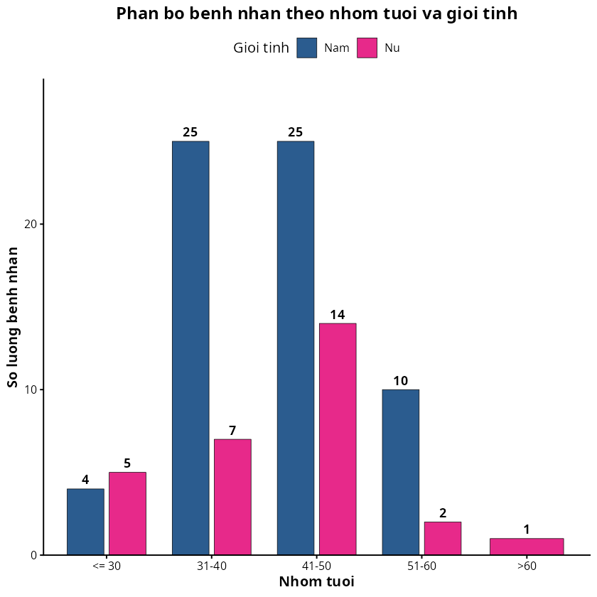
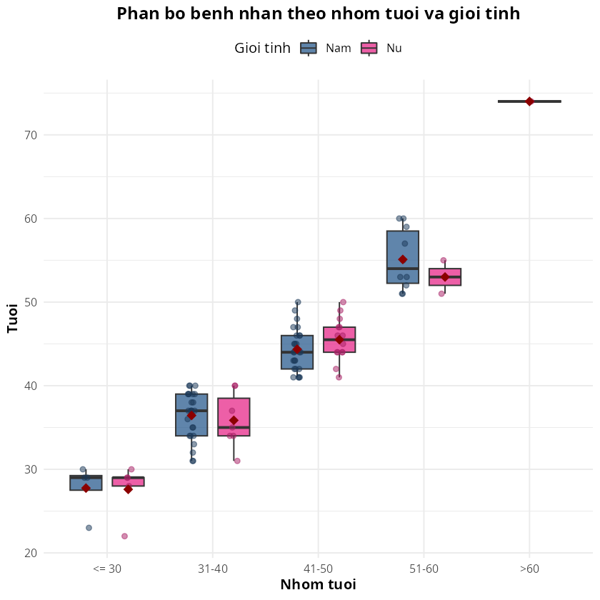
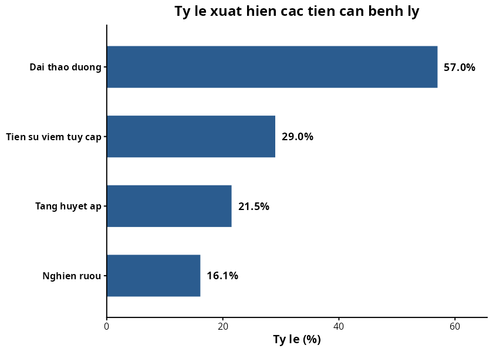
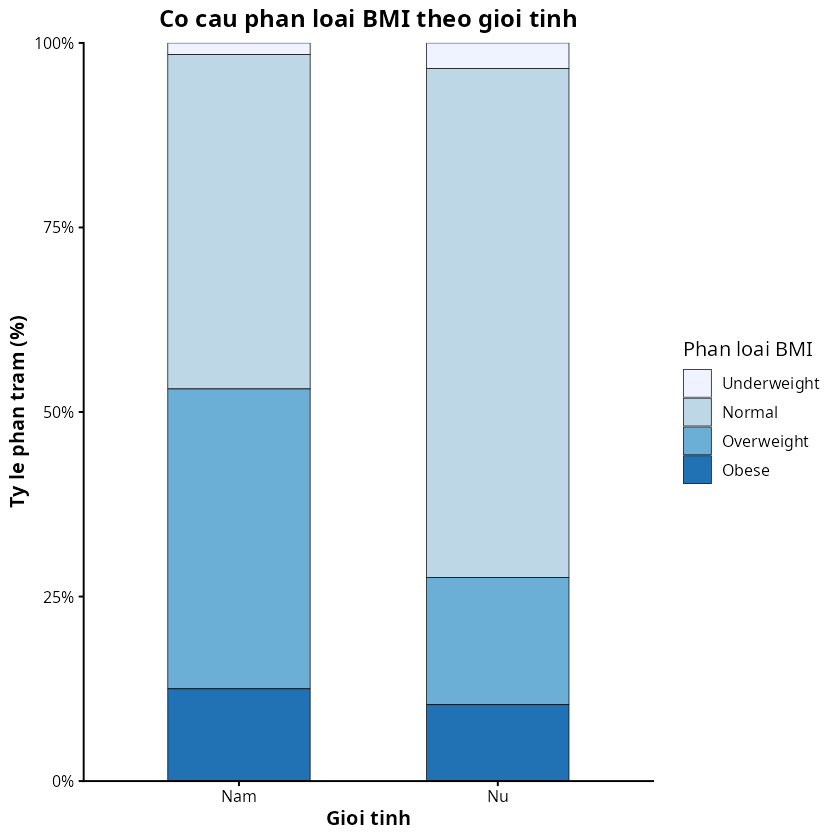
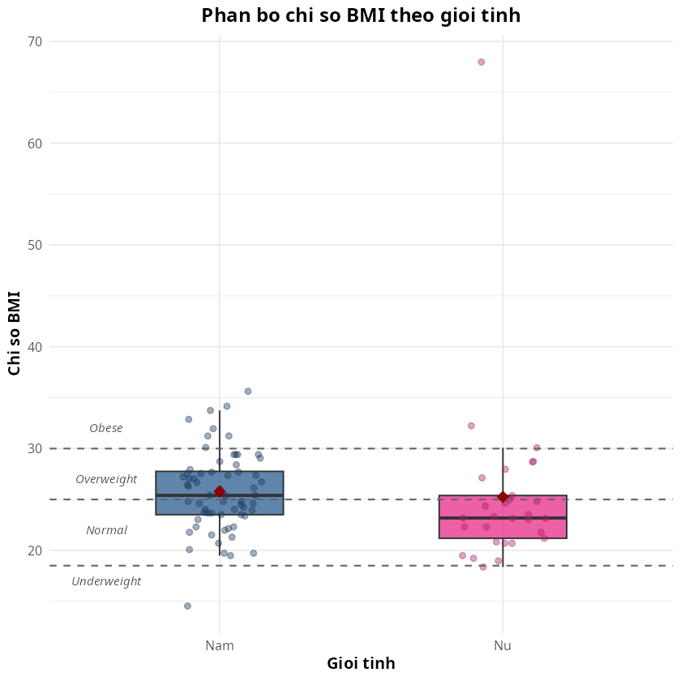
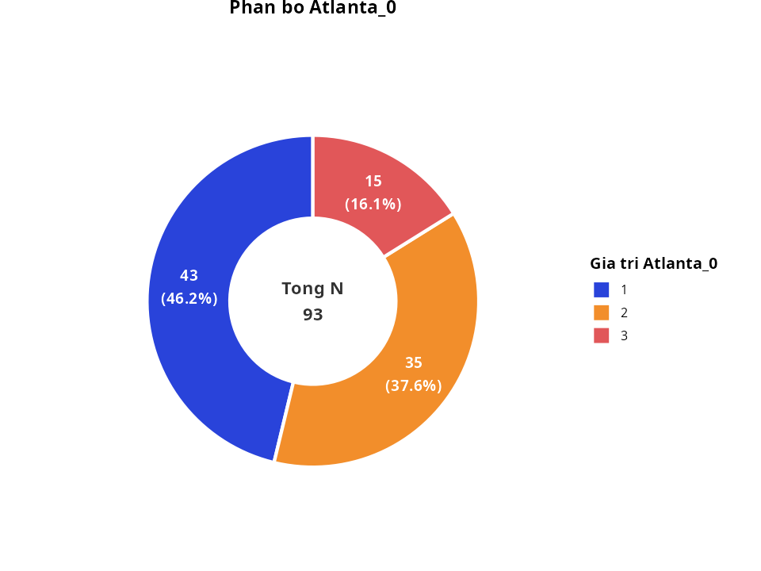
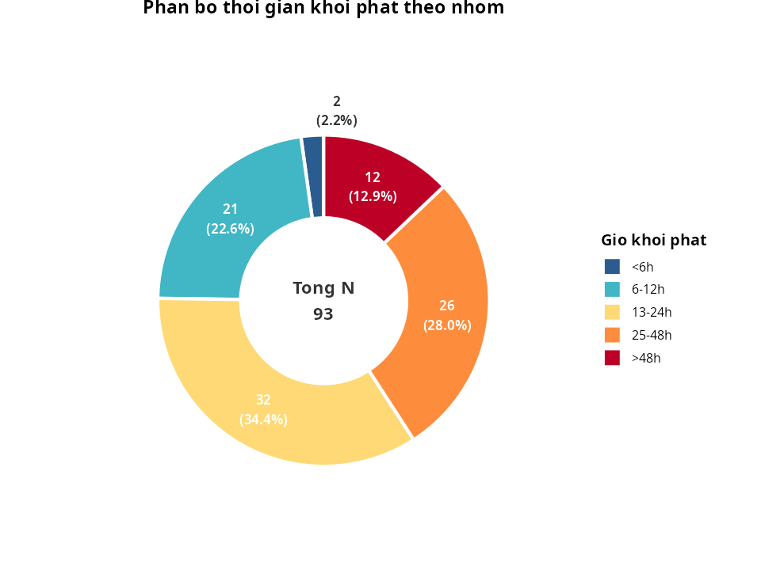

# Kết quả áp dụng phương pháp phân tích của luận án cho `Data_tong_hop.csv`

Mỗi bảng đặt kết quả từ dữ liệu cạnh số của luận án (cột **Luận án** hoặc **LA**) để đối chiếu. Số trong file này do `Data_analyzed.ipynb` sinh ra; không sửa tay, hãy chạy lại notebook.

## Tóm tắt khác biệt so với luận án

**Khớp với luận án:** tiền căn bệnh, phân nhóm BMI, nhóm thời gian khởi phát, BISAP ≥ 3, CTSI ≥ 6, APACHE II, TG trước và sau TPE, tỉ lệ giảm TG chung, Qb, Qr, số lần TPE và số ngày nằm viện trung bình.

**Khác và làm thay đổi cách diễn giải:**

| Nội dung | Luận án | Dữ liệu |
|:---|:---|:---|
| Tử vong | 4 (4.3%) | 6 (6.5%) |
| SOFA trước → sau TPE 1, albumin | 6.4 → 2.6 | 3.4 → 2.6 |
| SOFA trước → sau TPE 1, FFP | 8.5 → 4.7 | 5.6 → 4.8 |
| SOFA ≥ 7 | 49 ca; OR 17.2 | 21 ca; OR 4.00 |
| BISAP ≥ 3 và độ nặng | OR 22.0 | OR 6.30 |
| Hồi quy đa biến | Tuổi, creatinin, BISAP, SIRS có ý nghĩa; giải thích 45% | Chỉ BISAP có ý nghĩa ở mô hình 93 ca; không biến nào có ý nghĩa ở mô hình 7 biến; R² 0.19 và 0.10 |
| Nằm viện, albumin so với FFP | p = 0.014 | p = 0.146 |
| APACHE II sau TPE 2, albumin | Không có ý nghĩa, p = 0.639 | 11.8 → 8.1, p = 0.006 (n = 8) |
| Creatinin sau TPE 1, FFP | 1.6 → 1.1, p = 0.031 | 1.7 → 1.7, p = 0.264 |
| % giảm TG sau TPE 1, albumin; FFP | 83.2; 84.5 | 74.0; 79.1 |
| Thời gian TPE, albumin so với FFP | p = 0.008 | p = 0.073 |
| Heparin bolus, albumin so với FFP | p = 0.02 | p = 0.072 (n = 41) |
| Tốc độ thay thế, albumin so với FFP | p = 0.052 | p = 0.008 |
| Nhập viện đến TPE 1, albumin so với FFP | p = 0.042 | p = 0.854 (n = 57) |
| Thở máy, albumin so với FFP | 72.9% và 76.5%; p = 0.055 | 71.1% và 100%; p = 0.005 (n = 60) |
| Hạ kali sau TPE | 8 (8.6%) | 51 (54.8%) |
| Hạ canxi sau TPE | 6 (6.4%) | 26/42 (61.9%) |

**So sánh albumin 5% và FFP trong giảm TG:** xem mục *Phân tích sâu* ở cuối file.

**Không kiểm tra được vì thiếu biến:** phần lớn biến cố ở Bảng 3.26, các biện pháp điều trị ở Bảng 3.27, nhóm amylase và lipase ≥ 3 lần giới hạn trên, suy cơ quan thoáng qua hay kéo dài, BISAP sau TPE lần 2.

**Lưu ý chung:** độ nặng trong bảng 3.12–3.18 không phải Atlanta 2012 thật. Kết quả theo độ nặng chỉ dùng để đối chiếu với luận án, không nên dùng làm kết luận lâm sàng.

## Phương pháp (theo mục 2.8 của luận án)

- **Biến định tính:** tần số, tỉ lệ %; so sánh bằng χ² không hiệu chỉnh, dùng Fisher khi có tần số mong đợi < 5.
- **Biến định lượng:** kiểm định phân phối chuẩn bằng Kolmogorov-Smirnov (hiệu chỉnh Lilliefors). Chuẩn thì trình bày TB ± ĐLC và dùng t-test; không chuẩn thì thêm trung vị (Q1–Q3) và dùng Wilcoxon rank sum.
- **Trước - sau TPE:** t bắt cặp nếu hiệu số chuẩn, ngược lại Wilcoxon signed rank. Luận án ghi t-test cho hầu hết các bảng, nên có thêm cột `p t-test` để đối chiếu.
- **Mối liên quan với độ nặng:** OR Wald, KTC 95%; hồi quy logistic đa biến, p < 0.05.
- **Nhóm so sánh:** albumin 5% / FFP theo `PP_PEX1`; nặng (`Atlanta_0` = 3) / trung bình-nặng (`Atlanta_0` = 1, 2).
- **Nguồn dữ liệu:** biến CSV dùng 93 ca. Biến `bs_*` so sánh theo nhóm chỉ dùng 60 ca đã ghép. Thống kê chung của biến bổ sung dùng toàn bộ 93 ca trong `Bo_sung_an_danh.csv`.

## 3.1. Đặc điểm chung nhóm nghiên cứu

### Bảng 3.1. Phân bố theo tuổi (dữ liệu: nam 64, nữ 29; luận án: nam 66, nữ 27)

|Tuổi                                      |Chung      |Nam        |Nữ          |LA chung   |LA nam     |LA nữ                    |
|:-----------------------------------------|:----------|:----------|:-----------|:----------|:----------|:------------------------|
|TB ± ĐLC (p = 0.870, t; p t-test = 0.870) |41.8 ± 8.6 |41.9 ± 7.9 |41.6 ± 10.2 |40.2 ± 8.0 |39.7 ± 7.1 |41.4 ± 9.7 (p = 0.79, t) |
|≤ 30                                      |9 (9.7)    |4 (6.2)    |5 (17.2)    |10 (10.8)  |4 (6.1)    |6 (22.2)                 |
|31-40                                     |32 (34.4)  |25 (39.1)  |7 (24.1)    |38 (40.9)  |34 (51.5)  |4 (14.8)                 |
|41-50                                     |39 (41.9)  |25 (39.1)  |14 (48.3)   |38 (40.9)  |23 (34.8)  |15 (55.6)                |
|51-60                                     |12 (12.9)  |10 (15.6)  |2 (6.9)     |6 (6.5)    |5 (7.6)    |1 (3.7)                  |
|> 60                                      |1 (1.1)    |0 (0.0)    |1 (3.4)     |1 (1.1)    |0          |1 (3.7)                  |

*`tuoi` = 2023 − năm sinh. Tuổi nhập viện `bs_tuoi_nv`: 40.67 ± 8.83 ở 60 ca đã ghép; 40.34 ± 8.07 ở toàn bộ 93 ca của file bổ sung.*

### Bảng 3.2. Bệnh kèm theo

|Đặc điểm             |Chung     |Nam       |Nữ        |LA chung  |LA nam    |LA nữ     |
|:--------------------|:---------|:---------|:---------|:---------|:---------|:---------|
|Tiền căn ĐTĐ         |53 (57.0) |36 (56.2) |17 (58.6) |53 (57)   |35 (53.8) |18 (64.3) |
|Tăng huyết áp        |20 (21.5) |12 (18.8) |8 (27.6)  |20 (21.5) |12 (18.5) |8 (28.6)  |
|Rối loạn lipid máu   |20 (21.5) |11 (17.2) |9 (31.0)  |20 (21.5) |12 (18.1) |8 (29.6)  |
|Tiền căn nghiện rượu |15 (16.1) |15 (23.4) |0 (0.0)   |15 (16.1) |15 (23.1) |0         |
|Tiền căn VTC         |27 (29.0) |19 (29.7) |8 (27.6)  |27 (29)   |19 (29.2) |8 (28.6)  |
|Có thai              |4 (4.3)   |0 (0.0)   |4 (13.8)  |4 (4.3)   |0         |4 (14.8)  |

### Bảng 3.3. Phân độ BMI

|BMI                                              |Chung      |Nam        |Nữ         |LA chung   |LA nam     |LA nữ                    |
|:------------------------------------------------|:----------|:----------|:----------|:----------|:----------|:------------------------|
|TB ± ĐLC (p = 0.025, Wilcoxon; p t-test = 0.687) |25.6 ± 5.9 |25.8 ± 3.9 |25.2 ± 8.9 |25.6 ± 5.9 |25.8 ± 3.9 |25.2 ± 8.9 (p = 0.68, t) |
|Thiếu cân                                        |2 (2.2)    |1 (1.6)    |1 (3.4)    |2 (2.2)    |1 (1.5)    |1 (3.7)                  |
|Bình thường                                      |49 (52.7)  |29 (45.3)  |20 (69.0)  |49 (52.7)  |30 (45.5)  |19 (70.4)                |
|Thừa cân                                         |31 (33.3)  |26 (40.6)  |5 (17.2)   |31 (33.3)  |27 (40.9)  |4 (14.8)                 |
|Béo phì                                          |11 (11.8)  |8 (12.5)   |3 (10.3)   |11 (11.8)  |8 (12.1)   |3 (11.1)                 |

*Có 1 ca ngoại lai: nữ, 174 kg, cao 160 cm (BMI 68).*

### Bảng 3.4. Độ nặng viêm tụy cấp

|Độ nặng VTC                            |n (%)     |Luận án   |
|:--------------------------------------|:---------|:---------|
|Trung bình - nặng (`Atlanta_0` = 1, 2) |78 (83.9) |78 (83.9) |
|Nặng (`Atlanta_0` = 3)                 |15 (16.1) |15 (16.1) |

*Nhóm nặng gồm 3 ca gốc `Atlanta_0 = 0` đã gán lại thành 3 (STT 11, 55, 73). `Atlanta_0` được tính từ nhịp tim, nhịp thở và ure, không phải độ nặng Atlanta 2012 thật. Mọi bảng so sánh theo độ nặng bên dưới dùng cách chia nhóm này.*

### Bảng 3.5. Thời gian khởi phát đến nhập viện

|Thời gian (giờ) |Dữ liệu     |Luận án     |
|:---------------|:-----------|:-----------|
|TB ± ĐLC        |33.8 ± 20.1 |33.8 ± 20.2 |
|< 6             |2 (2.2)     |2 (2.2)     |
|6 - 12          |21 (22.6)   |21 (22.5)   |
|13 - 24         |32 (34.4)   |32 (34.4)   |
|25 - 48         |26 (28.0)   |26 (28.0)   |
|> 48            |12 (12.9)   |12 (12.9)   |

*`gio_khoi_phat` chỉ có 5 giá trị đã gộp nhóm, nên TB ± ĐLC chỉ là gần đúng. Giờ thật ở file bổ sung (`bs_gio_khoi_phat_den_nv`): 35.0 ± 31.0, n = 91.*

## 3.2. Lâm sàng, cận lâm sàng, thang điểm và biến chứng lúc nhập viện

### Bảng 3.6. Đặc điểm lâm sàng thời điểm nhập viện

|Đặc điểm                   |Dữ liệu n (%) |Luận án   |
|:--------------------------|:-------------|:---------|
|Đau bụng                   |85 (91.4)     |93 (100)  |
|Buồn nôn hoặc nôn          |48 (51.6)     |73 (78.4) |
|Sốt                        |11 (11.8)     |13 (13.9) |
|Tràn dịch màng phổi        |28 (30.1)     |46 (49.4) |
|Mạch nhanh > 100 l/p       |66 (71.0)     |62 (66.6) |
|Huyết áp thấp < 90/60 mmHg |12 (12.9)     |19 (20.4) |
|Chướng bụng                |Không có biến |80 (86)   |
|Đề kháng thành bụng        |Không có biến |26 (27.9) |
|Cảm ứng phúc mạc           |Không có biến |5 (5.4)   |
|Dấu Cullen / Grey Turner   |Không có biến |0         |

### Bảng 3.7. Đặc điểm xét nghiệm thời điểm nhập viện và sau 48 giờ

|Cận lâm sàng                               |Dữ liệu                                 |Nguồn           |Luận án         |
|:------------------------------------------|:---------------------------------------|:---------------|:---------------|
|CRP > 150 sau 48 giờ, n (%)                |33 (43.4)                               |Bổ sung, n = 76 |36 (38.7)       |
|BUN > 20 mg/dL lúc nhập viện, n (%)        |22 (30.6)                               |Bổ sung, n = 72 |27 (29.0)       |
|BUN > 20 và không giảm sau bù dịch, n (%)  |6 (8.3)                                 |Bổ sung         |16 (17.2)       |
|Hct > 44% lúc nhập viện, n (%)             |46 (49.5)                               |CSV             |40 (43.0)       |
|Hct > 44% và không giảm sau bù dịch, n (%) |3 (3.2)                                 |CSV             |10 (10.7)       |
|Creatinin > 1.9 mg/dL, n (%)               |26 (28.0)                               |CSV             |18 (19.3)       |
|Amylase có thực hiện, n (%)                |43 (46.2)                               |CSV             |43 (46.2)       |
|Lipase có thực hiện, n (%)                 |77 (82.8)                               |CSV             |77 (82.8)       |
|Glucose ≥ 200 mg/dL, n (%)                 |48 (51.6)                               |CSV             |47 (50.5)       |
|Glucose (mg/dL)                            |262.4 ± 200.1; 205.0 (131.0–328.0)      |CSV             |262.4 ± 200.1   |
|Hồng cầu (T/L)                             |5.0 ± 0.9                               |CSV             |5.1 ± 0.9       |
|Hct (%)                                    |44.4 ± 7.3                              |CSV             |43.1 ± 7.2      |
|Bạch cầu (G/L)                             |13.0 ± 5.5                              |CSV             |12.9 ± 5.1      |
|Tiểu cầu (G/L)                             |231.9 ± 89.1                            |CSV             |231.9 ± 89.1    |
|Neutrophil                                 |10.2 ± 7.8; 9.6 (6.9–12.3)              |Bổ sung         |10.3 ± 7.7      |
|Lymphocyte                                 |1.7 ± 1.2; 1.4 (0.9–1.9)                |Bổ sung         |1.6 ± 1.2       |
|Monocyte                                   |0.7 ± 0.5; 0.6 (0.4–0.8)                |Bổ sung         |0.7 ± 0.5       |
|PT (giây)                                  |15.2 ± 4.7; 14.0 (12.0–16.5)            |CSV             |14.9 ± 4.7      |
|APTT (giây)                                |35.4 ± 12.2; 32.0 (30.0–36.0)           |CSV             |35.4 ± 12.2     |
|BUN (mg/dL)                                |17.7 ± 11.7; 13.6 (9.9–23.2)            |Bổ sung         |17.6 ± 12.1     |
|`ure_0` (mg/dL)                            |24.9 ± 16.3; 20.6 (13.0–32.0)           |CSV             |–               |
|Creatinin (mg/dL)                          |1.46 ± 0.96; 1.18 (0.72–2.10)           |CSV             |1.28 ± 0.91     |
|Na⁺ (mmol/L)                               |127.9 ± 8.8                             |CSV             |132.8 ± 9.4     |
|K⁺ (mmol/L)                                |4.1 ± 0.8; 4.0 (3.5–4.6)                |CSV             |4.1 ± 0.8       |
|Canxi toàn phần (mmol/L)                   |2.1 ± 0.4; 2.2 (1.8–2.4)                |CSV, n = 44     |1.8 ± 0.2       |
|PaO₂/FiO₂                                  |337.9 ± 121.4; 387.7 (286.3–400.0)      |CSV, n = 86     |337.9 ± 121     |
|Triglyceride (mg/dL)                       |3987.3 ± 2918.3; 3000.0 (1894.0–5164.0) |CSV             |3987.3 ± 2918.3 |
|SII                                        |2111.9 ± 3043.4; 1458.2 (834.6–2510.3)  |Bổ sung, n = 86 |1863.2 ± 1405.1 |
|SIRI                                       |6.9 ± 17.0; 4.2 (2.3–6.9)               |Bổ sung, n = 86 |5.1 ± 4.4       |

*Ô định lượng có dạng TB ± ĐLC; biến không phân phối chuẩn theo Kolmogorov-Smirnov có thêm trung vị (Q1–Q3).*

*Không tính được nhóm amylase, lipase ≥ 3 lần giới hạn trên vì luận án không ghi giới hạn trên. Số ca của luận án tương ứng ngưỡng khoảng 240 U/L với amylase và 460–475 U/L với lipase.*

### Bảng 3.8. Đặc điểm hình ảnh học thời điểm nhập viện

|Cận lâm sàng               |Dữ liệu                   |Luận án    |
|:--------------------------|:-------------------------|:----------|
|Siêu âm: có thực hiện      |64 (68.8)                 |64 (68.8)  |
|Siêu âm: bình thường       |7 (10.9)                  |14 (21.8)  |
|Siêu âm: phù nề            |49 (76.6)                 |50 (78.1)  |
|Siêu âm: tụ dịch quanh tụy |48 (75.0)                 |43 (76.1)  |
|Siêu âm: hoại tử           |1 (1.6)                   |0          |
|Siêu âm: nang giả tụy      |0 (0.0)                   |0          |
|CT: có thực hiện           |84 (90.3)                 |87 (93.5)  |
|CT: giờ thực hiện          |8.9 ± 21.7; 2.0 (1.0–4.0) |8.8 ± 21.3 |
|CT: phù nề                 |79 (94.0)                 |86 (98.8)  |
|CT: tụ dịch quanh tụy      |82 (97.6)                 |85 (97.7)  |
|CT: hoại tử tụy            |29 (35.8)                 |32 (36.7)  |
|CT: nang giả tụy           |2 (2.4)                   |1 (1.1)    |
|CT: tắc mạch               |0 (0.0)                   |0          |

*Lấy từ `Bo_sung_an_danh.csv` (93 ca); các dòng hình ảnh tính trên số ca có thực hiện. CSV có `phu_ne_0` 29 ca, `tu_dich_0` 27 ca, `hoai_tu_0` 20 ca.*

### Bảng 3.9. Các thang điểm tiên lượng

|Thang điểm                |Dữ liệu n (%) |Luận án   |
|:-------------------------|:-------------|:---------|
|SOFA ≥ 7 (`sofa_0`)       |21 (22.6)     |49 (52.6) |
|SOFA ≥ 7 (`sofa_0` + 3)   |49 (52.7)     |49 (52.6) |
|BISAP ≥ 3                 |24 (25.8)     |24 (25.8) |
|CTSI ≥ 6                  |37 (39.8)     |37 (39.7) |
|SIRS ≥ 2 (`s_0`)          |63 (67.7)     |56 (60.2) |
|SIRS ≥ 2 (theo phụ lục 6) |77 (82.8)     |56 (60.2) |
|HAPS ≥ 1                  |62 (66.7)     |58 (62.3) |

*HAPS tính từ `creatinin_0`, `hct_0` và `bs_haps_vpm`; viêm phúc mạc chỉ có ở 60 ca đã ghép.*

*Dòng `sofa_0` + 3 chỉ để thấy nguồn gốc số của luận án, không phải giá trị đề xuất sử dụng.*

### Bảng 3.10. Độ nặng theo APACHE II, SOFA, BISAP

|Thang điểm |Chung      |Albumin 5% |FFP        |p     |Kiểm định |p t-test |Luận án (chung; albumin; FFP; p)          |
|:----------|:----------|:----------|:----------|:-----|:---------|:--------|:-----------------------------------------|
|APACHE II  |16.9 ± 8.2 |15.1 ± 7.6 |20.1 ± 8.5 |0.006 |Wilcoxon  |0.004    |16.9 ± 8.3; 15.0 ± 7.5; 20.0 ± 8.5; 0.006 |
|SOFA       |4.2 ± 3.0  |3.4 ± 2.6  |5.6 ± 3.2  |0.001 |Wilcoxon  |<0.001   |7.2 ± 3.0; 6.4 ± 2.6; 8.5 ± 3.1; 0.001    |
|BISAP      |1.8 ± 1.0  |1.7 ± 0.9  |1.9 ± 1.1  |0.519 |Wilcoxon  |0.374    |2 ± 1.2; 1.7 ± 0.8; 1.9 ± 1.0; 0.576      |

### Bảng 3.11. Biến chứng của viêm tụy cấp

|Biến chứng                           |Dữ liệu n (%) |Luận án   |
|:------------------------------------|:-------------|:---------|
|Biến chứng tại chỗ (tụ dịch trên CT) |82 (97.6)     |85 (97.7) |
|Nhiễm toan ceton                     |39 (42.9)     |39 (41.9) |
|Suy thận cấp                         |19 (20.9)     |18 (19.3) |
|Suy hô hấp                           |18 (19.8)     |69 (74.1) |
|Suy tim mạch                         |18 (19.8)     |19 (20.4) |
|Suy 1 cơ quan                        |13 (14.3)     |13 (13.9) |
|Suy 2 cơ quan                        |12 (13.2)     |11 (11.8) |
|Suy 3 cơ quan                        |6 (6.6)       |6 (6.4)   |
|Sốc (HATT < 90 hoặc vận mạch)        |19 (20.9)     |–         |

*Lấy từ `Bo_sung_an_danh.csv`; suy tạng theo cột PASS `Suy tạng` (n = 91). Không có dữ liệu phân thoáng qua / kéo dài.*

*Số suy hô hấp 69 của luận án trùng với số ca thở máy, không trùng với mã hô hấp trong cột Suy tạng.*

## 3.3. Mối liên quan với độ nặng (nặng n = 15, trung bình-nặng n = 78)

### Bảng 3.12. Bệnh đi kèm và độ nặng

|Đặc điểm             |Nặng n (%)  |TB-nặng n (%) |p     |Kiểm định |OR (KTC 95%)     |Luận án (nặng; TB-nặng; p; OR)               |
|:--------------------|:-----------|:-------------|:-----|:---------|:----------------|:--------------------------------------------|
|Tiền căn VTC         |5/15 (33.3) |22/78 (28.2)  |0.759 |Fisher    |1.27 (0.39–4.15) |3 (20.0); 24 (30.7); 0.405; 0.56 (0.15–2.18) |
|Đái tháo đường       |7/15 (46.7) |46/78 (59.0)  |0.378 |χ²        |0.61 (0.20–1.85) |9 (60.0); 44 (56.4); 0.797; 1.16 (0.38–3.57) |
|Tăng huyết áp        |4/15 (26.7) |16/78 (20.5)  |0.732 |Fisher    |1.41 (0.40–5.02) |5 (33.3); 15 (19.2); 0.223; 2.10 (0.62–7.06) |
|Rối loạn lipid máu   |2/15 (13.3) |18/78 (23.1)  |0.511 |Fisher    |0.51 (0.11–2.49) |1 (6.6); 19 (24.3); 0.159; 0.22 (0.03–1.80)  |
|Tiền căn nghiện rượu |3/15 (20.0) |12/78 (15.4)  |0.704 |Fisher    |1.38 (0.34–5.61) |4 (26.6); 11 (14.1); 0.226; 2.21 (0.60–8.21) |

### Bảng 3.13. Thời gian khởi phát đến nhập viện và độ nặng

|Đặc điểm                   |Nặng n (%)  |TB-nặng n (%) |p     |Kiểm định |OR (KTC 95%)     |Luận án (nặng; TB-nặng; p; OR)               |
|:--------------------------|:-----------|:-------------|:-----|:---------|:----------------|:--------------------------------------------|
|≥ 48 giờ (so với < 48 giờ) |6/15 (40.0) |32/78 (41.0)  |0.941 |χ²        |0.96 (0.31–2.96) |4 (26.7); 30 (38.4); 0.385; 0.58 (0.12–2.21) |

*Giá trị `gio_khoi_phat` = 48 là nhóm 25–48 giờ, nên mốc ≥ 48 giờ gồm cả nhóm này.*

### Bảng 3.14. Đặc điểm lâm sàng và độ nặng

|Đặc điểm        |Nặng n (%)   |TB-nặng n (%) |p     |Kiểm định |OR (KTC 95%)      |Luận án (nặng; TB-nặng; p; OR)                |
|:---------------|:------------|:-------------|:-----|:---------|:-----------------|:---------------------------------------------|
|Tuổi trung bình |42.3 ± 8.6   |41.7 ± 8.7    |0.823 |t         |–                 |41.9 ± 7.7; 39.9 ± 8.0; 0.38; –               |
|BMI ≥ 23        |11/15 (73.3) |58/78 (74.4)  |1.000 |Fisher    |0.95 (0.27–3.32)  |6 (40.0); 36 (46.1); 0.661; 0.78 (0.21–2.73)  |
|BMI ≥ 25        |6/15 (40.0)  |36/78 (46.2)  |0.661 |χ²        |0.78 (0.25–2.40)  |6 (40.0); 36 (46.1); 0.661; 0.78 (0.21–2.73)  |
|Giới nam        |13/15 (86.7) |51/78 (65.4)  |0.134 |Fisher    |3.44 (0.72–16.38) |12 (80.0); 54 (69.2); 0.751; 1.22 (0.32–5.79) |
|Sốt             |2/15 (13.3)  |9/78 (11.5)   |1.000 |Fisher    |1.18 (0.23–6.10)  |1 (6.6); 12 (15.3); 0.685; 0.39 (0.01–3.12)   |
|Mạch > 100 l/p  |9/15 (60.0)  |57/78 (73.1)  |0.356 |Fisher    |0.55 (0.18–1.74)  |7 (46.6); 48 (61.5); 0.283; 0.55 (0.15–1.94)  |
|Huyết áp thấp   |3/15 (20.0)  |9/78 (11.5)   |0.403 |Fisher    |1.92 (0.45–8.12)  |2 (13.3); 17 (21.7); 0.728; 0.55 (0.56–2.84)  |

*Luận án ghi BMI ≥ 23 nhưng tổng 42 ca của luận án bằng đúng số ca BMI ≥ 25 trong dữ liệu, nên có thêm dòng BMI ≥ 25.*

### Bảng 3.15. Đặc điểm cận lâm sàng và độ nặng

|Đặc điểm                                        |Nặng n (%)   |TB-nặng n (%) |χ²    |p     |Kiểm định |Luận án (nặng; TB-nặng; χ²; p)    |
|:-----------------------------------------------|:------------|:-------------|:-----|:-----|:---------|:---------------------------------|
|CRP > 150 (`bs_crp_sau_tpe_1`, ca đã ghép)      |3/7 (42.9)   |19/44 (43.2)  |–     |1.000 |Fisher    |4 (26.6); 32 (41.0); 1.093; 0.296 |
|Hct > 44%                                       |10/15 (66.7) |36/78 (46.2)  |2.118 |0.146 |χ²        |5 (33.3); 35 (44.8); 0.683; 0.408 |
|BUN > 20 mg/dL (`bs_bun_nhap_vien`, ca đã ghép) |6/9 (66.7)   |12/41 (29.3)  |–     |0.055 |Fisher    |5 (33.3); 21 (27.0); 0.257; 0.612 |
|`ure_0` > 20                                    |13/15 (86.7) |34/78 (43.6)  |9.339 |0.002 |χ²        |–                                 |
|Creatinin > 1.9 mg/dL                           |7/15 (46.7)  |19/78 (24.4)  |–     |0.114 |Fisher    |4 (26.6); 13 (16.7); 0.842; 0.359 |

*`ure_0` tham gia tính `Atlanta_0` nên dòng này gần như bị quyết định bởi cách chia nhóm.*

### Bảng 3.16. Mức độ tăng triglyceride và độ nặng

|Đặc điểm                           |Nặng n (%)   |TB-nặng n (%) |p     |Kiểm định |OR (KTC 95%)     |Luận án (nặng; TB-nặng; p; OR)               |
|:----------------------------------|:------------|:-------------|:-----|:---------|:----------------|:--------------------------------------------|
|TG ≥ 2000 mg/dL (so với 1000–1999) |10/15 (66.7) |55/78 (70.5)  |0.765 |Fisher    |0.84 (0.26–2.72) |10 (66.7); 55 (70.5); 0.76; 0.84 (0.26–2.72) |

### Bảng 3.17. Thang điểm tiên lượng và độ nặng

|Đặc điểm                |Nặng n (%)   |TB-nặng n (%) |p     |Kiểm định |OR (KTC 95%)      |Luận án (nặng; TB-nặng; p; OR)                |
|:-----------------------|:------------|:-------------|:-----|:---------|:-----------------|:---------------------------------------------|
|BISAP ≥ 3               |9/15 (60.0)  |15/78 (19.2)  |0.002 |Fisher    |6.30 (1.94–20.43) |12 (80.0); 12 (15.4); <0.001; 22.0 (5.4–89.8) |
|SOFA ≥ 7 (`sofa_0`)     |7/15 (46.7)  |14/78 (17.9)  |0.037 |Fisher    |4.00 (1.24–12.86) |14 (93.3); 35 (44.9); 0.007; 17.2 (2.2–137.3) |
|SOFA ≥ 7 (`sofa_0` + 3) |12/15 (80.0) |37/78 (47.4)  |0.021 |χ²        |4.43 (1.16–16.94) |14 (93.3); 35 (44.9); 0.007; 17.2 (2.2–137.3) |
|CTSI ≥ 6                |8/15 (53.3)  |29/78 (37.2)  |0.242 |χ²        |1.93 (0.63–5.88)  |9 (60.0); 28 (35.9); 0.081; 2.68 (0.86–8.31)  |
|SIRS ≥ 2 (`s_0`)        |12/15 (80.0) |51/78 (65.4)  |0.371 |Fisher    |2.12 (0.55–8.16)  |12 (80.0); 44 (56.4); 0.087; 3.09 (0.74–18.2) |
|HAPS ≥ 1                |13/15 (86.7) |49/78 (62.8)  |0.073 |χ²        |3.85 (0.81–18.27) |8 (53.3); 44 (56.4); 0.826; 0.88 (0.25–3.17)  |

*Luận án ghi phép kiểm Wilcoxon rank-sum cho bảng này; ở đây dùng χ²/Fisher theo mục 2.8 vì biến là nhị giá.*

### Bảng 3.18A. Hồi quy logistic đa biến, không có SIRI (n = 93, 15 biến cố, R² Nagelkerke = 0.19)

|Đặc tính              |p hiệu chỉnh |OR hiệu chỉnh (KTC 95%) |Luận án (p; OR)         |
|:---------------------|:------------|:-----------------------|:-----------------------|
|Tuổi                  |0.941        |1.00 (0.93–1.07)        |0.022; 1.1 (1.01–1.2)   |
|Creatinin > 1.9 mg/dL |0.545        |1.52 (0.39–5.91)        |0.023; 19.4 (1.5–250)   |
|BISAP ≥ 3             |0.019        |5.68 (1.33–24.27)       |<0.001; 71.4 (7.7–661)  |
|SIRS ≥ 2              |0.865        |1.15 (0.23–5.79)        |0.046; 5.0 (1.03–24.4)  |
|Glucose               |0.798        |1.00 (1.00–1.00)        |0.209; 1.00 (0.99–1.01) |
|Bạch cầu > 16 G/L     |0.377        |0.50 (0.10–2.35)        |0.267; 0.3 (0.03–2.54)  |

### Bảng 3.18B. Hồi quy logistic đa biến, đủ 7 biến như luận án (n = 58, 9 biến cố, R² Nagelkerke = 0.10)

|Đặc tính              |p hiệu chỉnh |OR hiệu chỉnh (KTC 95%) |Luận án (p; OR)         |
|:---------------------|:------------|:-----------------------|:-----------------------|
|Tuổi                  |0.693        |1.02 (0.93–1.11)        |0.022; 1.1 (1.01–1.2)   |
|Creatinin > 1.9 mg/dL |0.876        |1.15 (0.19–6.92)        |0.023; 19.4 (1.5–250)   |
|BISAP ≥ 3             |0.244        |3.01 (0.47–19.18)       |<0.001; 71.4 (7.7–661)  |
|SIRS ≥ 2              |0.687        |1.48 (0.22–10.02)       |0.046; 5.0 (1.03–24.4)  |
|Glucose               |0.866        |1.00 (1.00–1.00)        |0.209; 1.00 (0.99–1.01) |
|Bạch cầu > 16 G/L     |0.563        |1.79 (0.25–12.97)       |0.267; 0.3 (0.03–2.54)  |
|SIRI                  |0.685        |0.96 (0.78–1.17)        |0.126; 0.8 (0.6–1.1)    |

*SIRI chỉ có ở ca đã ghép nên mô hình B chỉ có ít biến cố cho 7 biến; kết quả không ổn định và chỉ để đối chiếu. Luận án báo cáo khả năng giải thích 45%.*

*`Atlanta_0` được tính từ nhịp tim, nhịp thở và ure, trong khi `s_0` dùng nhịp tim, nhịp thở và `b_0` của BISAP dùng ure. Biến kết cục và biến dự báo trùng thành phần, nên liên quan với SIRS, BISAP không nên diễn giải là khả năng tiên lượng.*

## 3.4. Kết quả thay huyết tương

### Bảng 3.19. Thời gian thay huyết tương (giờ)

|Đặc điểm                |  n|Chung       |Albumin 5%  |FFP         |p     |Kiểm định |p t-test |Luận án (chung; albumin; FFP; p)             |
|:-----------------------|--:|:-----------|:-----------|:-----------|:-----|:---------|:--------|:--------------------------------------------|
|Khởi phát đến TPE lần 1 | 57|49.8 ± 23.0 |53.4 ± 23.7 |43.1 ± 20.4 |0.105 |t         |0.105    |35.5 ± 20.2; 31.9 ± 19.4; 36.2 ± 21.9; 0.023 |
|Nhập viện đến TPE lần 1 | 57|19.1 ± 14.9 |20.0 ± 16.9 |17.3 ± 10.1 |0.854 |Wilcoxon  |0.511    |25.5 ± 18.2; 21.9 ± 18.5; 28.3 ± 11.5; 0.042 |
|TPE lần 1 đến TPE lần 2 |  8|15.9 ± 7.7  |15.8 ± 11.2 |16.0 ± 3.8  |0.663 |Wilcoxon  |0.968    |18.2 ± 8.6; 16.3 ± 6.4; 21.5 ± 7.2; 0.035    |

*Tính từ `thoi_gian_nhap_vien`, `onset_pex_0`, `onset_pex_1`, chỉ dùng các ca có đủ ngày và giờ, khoảng hợp lệ 0–240 giờ. Ô chỉ có số serial Excel hoặc thiếu giờ bị loại. `gio_khoi_phat` đã gộp nhóm nên khởi phát đến TPE chỉ là gần đúng.*

### Biểu đồ 3.2. Số lần thay huyết tương

|Số lần TPE |Dữ liệu n (%) |Luận án |
|:----------|:-------------|:-------|
|1 lần      |80 (86.0)     |86%     |
|2 lần      |13 (14.0)     |14%     |

### Bảng 3.20. Thông số quá trình thay huyết tương

|Đặc điểm                 |  n|Chung          |Albumin 5%     |FFP             |p     |Kiểm định |p t-test |Luận án (chung; albumin; FFP; p)                |
|:------------------------|--:|:--------------|:--------------|:---------------|:-----|:---------|:--------|:-----------------------------------------------|
|Dịch thay thế (mL)       | 93|3747.3 ± 915.4 |3920.3 ± 885.1 |3447.1 ± 901.6  |0.016 |t         |0.016    |3418.9 ± 739; 3518.6 ± 786; 3157 ± 523; 0.014   |
|Tốc độ rút máu (mL/phút) | 93|171.1 ± 24.1   |171.0 ± 22.4   |171.2 ± 27.2    |0.618 |Wilcoxon  |0.976    |171.1 ± 24.1; 171 ± 22.4; 171.2 ± 27.2; 0.72    |
|Tốc độ thay thế (mL/giờ) | 93|1325.3 ± 274.9 |1280.5 ± 280.4 |1402.9 ± 250.4  |0.008 |Wilcoxon  |0.038    |1325.3 ± 274; 1280.5 ± 280; 1402.9 ± 250; 0.052 |
|Heparin bolus (UI)       | 41|2095.1 ± 958.4 |2237.5 ± 907.9 |1588.9 ± 1014.2 |0.072 |t         |0.072    |2227 ± 852; 2328.8 ± 796; 1630 ± 965; 0.02      |
|Heparin duy trì (UI/giờ) | 41|701.2 ± 323.2  |742.2 ± 313.7  |555.6 ± 332.1   |0.127 |t         |0.127    |729.2 ± 299; 761.3 ± 287; 540 ± 316.9; 0.03     |
|Thời gian TPE (giờ)      | 93|3.24 ± 0.62    |3.31 ± 0.68    |3.12 ± 0.48     |0.073 |Wilcoxon  |0.140    |2.8 ± 0.6; 2.9 ± 0.2; 2.6 ± 0.4; 0.008          |

*Heparin chỉ có dữ liệu ở 41 ca, trong khi luận án ghi 100% ca dùng heparin.*

### Bảng 3.21. Thay đổi triglyceride sau TPE bằng albumin 5%

|Giai đoạn                 |Trước           |Sau           |% giảm |p      |Kiểm định    |p t cặp |Luận án                                           |
|:-------------------------|:---------------|:-------------|:------|:------|:------------|:-------|:-------------------------------------------------|
|TPE lần 1 (n = 59)        |3693.5 ± 2820.9 |755.8 ± 565.2 |74.0   |<0.001 |Wilcoxon cặp |<0.001  |3693.5 ± 2820.9 → 591.5 ± 366.7; 83.2%; p < 0.001 |
|TPE lần 2 (n = 8)         |1803.0 ± 486.5  |642.0 ± 212.4 |62.8   |<0.001 |t cặp        |<0.001  |1803.0 ± 486.5 → 642.0 ± 212.7; 64.4%; p < 0.001  |
|Giảm TG chung (`tg_giam`) |3005.9 ± 2585.0 |195 – 11487   |76.1   |–      |–            |–       |3005.9 ± 2585; 763 – 11487; 76.1%                 |

### Bảng 3.22. Thay đổi xét nghiệm sau TPE bằng albumin 5%

|Đặc điểm          | TPE 1: n|Trước → sau                       |p      |Kiểm định    |p t cặp |Luận án TPE 1                    | TPE 2: n|Trước → sau                   |p     |Luận án TPE 2                   |
|:-----------------|--------:|:---------------------------------|:------|:------------|:-------|:--------------------------------|--------:|:-----------------------------|:-----|:-------------------------------|
|Bạch cầu (G/L)    |       59|13.4 ± 5.0 → 10.3 ± 4.6           |<0.001 |t cặp        |<0.001  |12.6 ± 4.5 → 10.8 ± 4.7; 0.034   |        8|7.7 ± 2.4 → 8.6 ± 2.3         |0.515 |7.8 ± 2.2 → 8.3 ± 1.9; 0.67     |
|Hct (%)           |       59|44.0 ± 6.8 → 37.6 ± 6.5           |<0.001 |t cặp        |<0.001  |42.9 ± 6.2 → 36.9 ± 6; 0.028     |        8|34.9 ± 6.0 → 36.3 ± 4.5       |0.618 |36.6 ± 8.7 → 36 ± 4.6; 0.89     |
|Tiểu cầu          |       59|241.3 ± 87.1 → 168.3 ± 73.9       |<0.001 |Wilcoxon cặp |<0.001  |238.6 ± 83 → 160 ± 72; 0.001     |        8|191.8 ± 64.7 → 136.6 ± 69.4   |0.077 |195.1 ± 41 → 166 ± 58; 0.14     |
|APTT (giây)       |       59|34.7 ± 13.7 → 53.0 ± 26.7         |<0.001 |Wilcoxon cặp |<0.001  |34.1 ± 12 → 50.1 ± 23; 0.022     |        8|60.2 ± 33.1 → 52.1 ± 36.3     |0.682 |45.5 ± 18.3 → 50.9 ± 32; 0.41   |
|Amylase (U/L)     |        4|897.0 ± 650.5 → 837.0 ± 1100.7    |0.855  |Wilcoxon cặp |0.892   |653 ± 765 → 278 ± 323; 0.009     |        0|– → –                         |–     |189.6 ± 363 → 160 ± 321; 0.56   |
|Lipase (U/L)      |       26|1280.6 ± 1312.9 → 541.1 ± 914.6   |<0.001 |Wilcoxon cặp |<0.001  |741 ± 1139 → 182 ± 534; 0.001    |        2|232.0 ± 49.5 → 132.5 ± 120.9  |–     |120.5 ± 575 → 115 ± 534; 0.32   |
|CRP               |       30|120.2 ± 110.5 → 132.4 ± 85.7      |0.548  |t cặp        |0.548   |226.2 ± 132 → 101 ± 113; 0.045   |        1|201.6 → 59.4                  |–     |95.5 ± 56.8 → 89 ± 43.4; 0.35   |
|BUN (mg/dL)       |       28|18.5 ± 12.6 → 16.0 ± 14.2         |0.243  |t cặp        |0.243   |10.3 ± 8.4 → 7.5 ± 7.7; <0.001   |        1|12.0 → 5.4                    |–     |4.2 ± 9.7 → 6.3 ± 9.8; 0.20     |
|Creatinin (mg/dL) |       59|1.3 ± 0.9 → 1.1 ± 0.9             |0.007  |Wilcoxon cặp |0.041   |0.9 ± 0.4 → 0.7 ± 0.3; 0.001     |        8|0.5 ± 0.3 → 0.6 ± 0.2         |0.891 |0.5 ± 0.4 → 0.6 ± 0.3; 0.33     |
|SII               |       34|2168.9 ± 1465.5 → 1472.7 ± 1107.9 |0.002  |Wilcoxon cặp |0.002   |1842 ± 1383 → 1345 ± 1161; 0.001 |        2|828.3 ± 450.5 → 827.8 ± 136.5 |–     |1452 ± 1175 → 1782 ± 1138; 0.54 |
|SIRI              |       33|5.0 ± 4.0 → 4.4 ± 4.7             |0.300  |Wilcoxon cặp |0.466   |5.1 ± 4.2 → 4.8 ± 52; 0.63       |        2|2.0 ± 2.2 → 3.7 ± 0.2         |–     |3.0 ± 2.2 → 3.6 ± 1.9; 0.61     |
|PaO₂/FiO₂         |       53|367.8 ± 101.5 → 380.8 ± 80.8      |0.440  |t cặp        |0.440   |390 ± 77.3 → 390 ± 55; 0.06      |        8|434.6 ± 63.4 → 409.8 ± 42.0   |0.466 |404.8 ± 66 → 421.4; 0.07        |

### Bảng 3.23. Thay đổi triglyceride sau TPE bằng FFP

|Giai đoạn                 |Trước           |Sau           |% giảm |p      |Kiểm định    |p t cặp |Luận án                                           |
|:-------------------------|:---------------|:-------------|:------|:------|:------------|:-------|:-------------------------------------------------|
|TPE lần 1 (n = 34)        |4497.2 ± 3055.2 |863.8 ± 864.2 |79.1   |<0.001 |Wilcoxon cặp |<0.001  |4497.2 ± 3055.2 → 619.5 ± 470.7; 84.5%; p < 0.001 |
|TPE lần 2 (n = 5)         |2284.0 ± 1286.9 |532.2 ± 208.1 |74.5   |0.024  |t cặp        |0.024   |2284.9 ± 1286.9 → 532.2 ± 208.1; 76.7%; p < 0.001 |
|Giảm TG chung (`tg_giam`) |3733.6 ± 2617.9 |761 – 11250   |80.8   |–      |–            |–       |3733.6 ± 2617.9; 761 – 11250; 80.7%               |

### Bảng 3.24. Thay đổi xét nghiệm sau TPE bằng FFP

|Đặc điểm          | TPE 1: n|Trước → sau                       |p      |Kiểm định    |p t cặp |Luận án TPE 1                   | TPE 2: n|Trước → sau                      |p     |Luận án TPE 2                 |
|:-----------------|--------:|:---------------------------------|:------|:------------|:-------|:-------------------------------|--------:|:--------------------------------|:-----|:-----------------------------|
|Bạch cầu (G/L)    |       34|12.2 ± 6.3 → 9.9 ± 3.8            |0.005  |Wilcoxon cặp |0.025   |12 ± 6.3 → 9 ± 5.3; 0.001       |        5|10.8 ± 1.6 → 9.9 ± 1.4           |0.070 |10.0 ± 2.2 → 9.9 ± 1.9; 0.97  |
|Hct (%)           |       34|45.1 ± 8.2 → 34.5 ± 6.6           |<0.001 |t cặp        |<0.001  |44 ± 8.2 → 34 ± 5.1; 0.001      |        5|37.4 ± 9.0 → 34.2 ± 3.9          |0.266 |34.2 ± 3.2 → 33 ± 1.8; 0.26   |
|Tiểu cầu          |       34|215.8 ± 91.4 → 124.6 ± 75.4       |<0.001 |t cặp        |<0.001  |232.6 ± 85 → 188.5 ± 42; 0.001  |        5|148.8 ± 51.0 → 177.0 ± 79.0      |0.370 |210.1 ± 41 → 190 ± 45; 0.26   |
|APTT (giây)       |       34|36.7 ± 9.0 → 46.3 ± 22.6          |0.054  |Wilcoxon cặp |0.025   |34 ± 8.9 → 38 ± 7.24; 0.022     |        5|39.2 ± 11.3 → 38.4 ± 12.9        |0.898 |36.5 ± 6.98 → 34 ± 6.30; 0.24 |
|Amylase (U/L)     |        5|904.0 ± 769.7 → 451.0 ± 549.6     |0.015  |t cặp        |0.015   |582 ± 325 → 265 ± 354; 0.043    |        0|– → –                            |–     |180 ± 125 → 90 ± 73; 0.03     |
|Lipase (U/L)      |        6|1460.7 ± 1834.0 → 577.2 ± 959.1   |0.036  |Wilcoxon cặp |0.064   |759 ± 1062 → 242 ± 132; 0.018   |        0|– → –                            |–     |140 ± 93 → 80 ± 32; 0.01      |
|CRP               |       13|171.4 ± 106.5 → 201.8 ± 102.5     |0.404  |t cặp        |0.404   |220 ± 134 → 111 ± 123; 0.035    |        3|222.0 ± 139.1 → 96.8 ± 31.3      |0.423 |90.5 ± 59 → 86.4 ± 63; 0.36   |
|BUN (mg/dL)       |       20|21.0 ± 12.9 → 18.1 ± 13.7         |0.052  |Wilcoxon cặp |0.111   |13.6 ± 9.5 → 8.7 ± 7.2; 0.001   |        4|20.5 ± 25.0 → 16.8 ± 6.7         |0.855 |6.3 ± 4.2 → 5.2 ± 6.7; 0.25   |
|Creatinin (mg/dL) |       34|1.7 ± 1.0 → 1.7 ± 1.3             |0.264  |Wilcoxon cặp |0.782   |1.6 ± 0.9 → 1.1 ± 0.9; 0.031    |        5|1.3 ± 1.6 → 1.6 ± 1.5            |1.000 |0.7 ± 0.5 → 0.6 ± 0.4; 0.07   |
|SII               |       22|1765.7 ± 1297.2 → 1673.0 ± 1527.4 |0.346  |Wilcoxon cặp |0.715   |1898 ± 1462 → 1554 ± 1441; 0.15 |        4|1916.7 ± 1579.1 → 1359.8 ± 645.5 |0.584 |1097 ± 786 → 1274 ± 860; 0.86 |
|SIRI              |       22|4.9 ± 5.0 → 6.5 ± 8.3             |0.256  |Wilcoxon cặp |0.261   |5.3 ± 4.9 → 6.1 ± 7.7; 0.52     |        4|3.6 ± 2.4 → 2.5 ± 0.7            |1.000 |2.6 ± 1.0 → 3.7 ± 1.5; 0.49   |
|PaO₂/FiO₂         |       33|289.8 ± 136.2 → 384.6 ± 115.1     |0.005  |t cặp        |0.005   |286 ± 136 → 381 ± 113; 0.004    |        5|380.4 ± 121.4 → 422.2 ± 77.6     |0.632 |423.3 ± 89 → 416 ± 77; 0.91   |

*Ghi chú bảng 3.22 và 3.24: CRP, BUN, SII, SIRI lấy từ các ca đã ghép. Mốc "trước TPE lần 2" là giá trị `_1` vì dữ liệu không có đo riêng trước lần 2.*

### Bảng 3.25. Hiệu quả giảm triglyceride theo dịch thay thế

|TG (mg/dL)    |Chung                        |Albumin 5%                   |FFP                          |p     |Kiểm định    |p t-test |Luận án (chung; albumin; FFP; p)                                                           |
|:-------------|:----------------------------|:----------------------------|:----------------------------|:-----|:------------|:--------|:------------------------------------------------------------------------------------------|
|Trước TPE     |3987.3 ± 2918.3 [1023–13500] |3693.5 ± 2820.9 [1050–13370] |4497.2 ± 3055.2 [1023–13500] |0.079 |Wilcoxon     |0.203    |3987.3 ± 2918.2; 3693.5 ± 2820.9; 4497.2 ± 3055.2; 0.079                                   |
|Sau TPE       |795.3 ± 687.0 [136–4150]     |755.8 ± 565.2 [181–2620]     |863.8 ± 864.2 [136–4150]     |0.864 |Wilcoxon     |0.468    |795.3 ± 687; 755.8 ± 565.2; 863.8 ± 864.2; 0.861                                           |
|Mức giảm TG   |3271.9 ± 2606.8 [195–11487]  |3005.9 ± 2585.0 [195–11487]  |3733.6 ± 2617.9 [761–11250]  |0.068 |Wilcoxon     |0.196    |3271.9 ± 2608.8 [763–11487]; 3005.9 ± 2585 [763–11487]; 3733.6 ± 2617.9 [761–11250]; 0.196 |
|Tỉ lệ % giảm  |77.8                         |76.1                         |80.8                         |0.175 |Wilcoxon     |0.122    |77.8; 76.1; 80.7; 0.174                                                                    |
|p trước - sau |<0.001                       |<0.001                       |<0.001                       |–     |Wilcoxon cặp |–        |<0.001; <0.001; <0.001                                                                     |

*`tg_giam` dùng `tg_NV − tg_1` ở 89 ca và `tg_NV − tg_2` ở 4 ca. Luận án ghi sau TPE lần 1 là 591.5 và 619.5 ở Bảng 3.21, 3.23 nhưng 755.8 và 863.8 ở Bảng 3.25; dữ liệu chỉ khớp số của Bảng 3.25.*

### Biểu đồ 3.3 - 3.8. Thay đổi APACHE II, SOFA, BISAP sau TPE

|Thang điểm |Nhóm       |Giai đoạn                               |Trước → sau             |p      |Kiểm định    |p t cặp |Luận án                         |
|:----------|:----------|:---------------------------------------|:-----------------------|:------|:------------|:-------|:-------------------------------|
|APACHE II  |Albumin 5% |TPE 1 (n = 59)                          |15.1 ± 7.6 → 9.4 ± 5.7  |<0.001 |Wilcoxon cặp |<0.001  |15.0 ± 7.5 → 9.3 ± 5.6; <0.001  |
|APACHE II  |Albumin 5% |TPE 2, chỉ ca TPE 2 lần (n = 8)         |11.8 ± 4.8 → 8.1 ± 5.2  |0.006  |t cặp        |0.006   |→ 8.9 ± 5.6; 0.639              |
|APACHE II  |Albumin 5% |TPE 2, cả nhóm gồm ca chép lại (n = 59) |9.4 ± 5.7 → 8.9 ± 5.7   |0.014  |Wilcoxon cặp |0.018   |→ 8.9 ± 5.6; 0.639              |
|APACHE II  |FFP        |TPE 1 (n = 34)                          |20.1 ± 8.5 → 12.4 ± 7.0 |<0.001 |Wilcoxon cặp |<0.001  |20.0 ± 8.5 → 12.4 ± 7.0; <0.001 |
|APACHE II  |FFP        |TPE 2, chỉ ca TPE 2 lần (n = 5)         |8.6 ± 5.8 → 10.8 ± 7.6  |0.892  |Wilcoxon cặp |0.565   |0.851                           |
|APACHE II  |FFP        |TPE 2, cả nhóm gồm ca chép lại (n = 34) |12.4 ± 7.0 → 12.8 ± 7.1 |0.892  |Wilcoxon cặp |0.512   |0.851                           |
|SOFA       |Albumin 5% |TPE 1 (n = 59)                          |3.4 ± 2.6 → 2.6 ± 2.6   |<0.001 |Wilcoxon cặp |<0.001  |6.4 ± 2.6 → 2.6 ± 2.6; <0.001   |
|SOFA       |Albumin 5% |TPE 2, chỉ ca TPE 2 lần (n = 8)         |2.1 ± 1.8 → 1.2 ± 1.7   |0.089  |Wilcoxon cặp |0.041   |0.802                           |
|SOFA       |Albumin 5% |TPE 2, cả nhóm gồm ca chép lại (n = 59) |2.6 ± 2.6 → 2.8 ± 3.2   |0.551  |Wilcoxon cặp |0.414   |0.802                           |
|SOFA       |FFP        |TPE 1 (n = 34)                          |5.6 ± 3.2 → 4.8 ± 3.2   |<0.001 |Wilcoxon cặp |<0.001  |8.5 ± 3.1 → 4.7 ± 3.1; <0.001   |
|SOFA       |FFP        |TPE 2, chỉ ca TPE 2 lần (n = 5)         |3.8 ± 2.8 → 2.6 ± 1.8   |0.371  |Wilcoxon cặp |0.208   |0.570                           |
|SOFA       |FFP        |TPE 2, cả nhóm gồm ca chép lại (n = 34) |4.8 ± 3.2 → 4.3 ± 3.2   |0.223  |Wilcoxon cặp |0.184   |0.570                           |
|BISAP      |Albumin 5% |TPE 1 (n = 59)                          |1.7 ± 0.9 → 0.9 ± 0.9   |<0.001 |Wilcoxon cặp |<0.001  |1.7 ± 0.8 → 0.9 ± 0.8; <0.001   |
|BISAP      |Albumin 5% |TPE 2                                   |Không có `bisap_2`      |–      |–            |–       |0.678                           |
|BISAP      |FFP        |TPE 1 (n = 34)                          |1.9 ± 1.1 → 1.4 ± 0.8   |0.004  |Wilcoxon cặp |0.003   |1.9 ± 1.0 → 1.4 ± 0.8; <0.001   |
|BISAP      |FFP        |TPE 2                                   |Không có `bisap_2`      |–      |–            |–       |0.663                           |

*SOFA sau TPE của luận án (2.6; 4.7) khớp `sofa_1`, nhưng SOFA trước TPE (6.4; 8.5) bằng `sofa_0` + 3. Vì vậy mức giảm SOFA trong luận án lớn hơn dữ liệu khoảng 3 điểm.*

*Ở ca TPE 1 lần, `apache_ii_2` và phần lớn `sofa_2` chép lại giá trị `_1`. Số 8.9 của luận án khớp với cách tính gồm cả các ca chép lại.*

## 3.4.8. Biến cố liên quan đến thay huyết tương

### Bảng 3.26. Biến cố liên quan đến thay huyết tương

|Biến cố                                |Chung         |Albumin 5% |FFP       |Luận án (chung; albumin; FFP) |
|:--------------------------------------|:-------------|:----------|:---------|:-----------------------------|
|Đông màng lọc sớm (`so_qua_loc_1` > 1) |9 (9.7)       |7 (11.9)   |2 (5.9)   |7 (7.5); 5 (8.5); 2 (5.9)     |
|Hạ kali sau TPE (`k_1` < 3.5), n = 93  |51 (54.8)     |31 (52.5)  |20 (58.8) |8 (8.6); 6 (10.2); 2 (5.9)    |
|Hạ canxi sau TPE (`ca_1` < 2), n = 42  |26 (61.9)     |17 (65.4)  |9 (56.2)  |6 (6.4); 2 (3.3); 4 (11.7)    |
|Tắc catheter                           |Không có biến |–          |–         |4 (4.3); 2 (3.4); 2 (5.9)     |
|Phản ứng phản vệ                       |Không có biến |–          |–         |4 (4.3); 0; 4 (11.7)          |
|Xuất huyết tiêu hóa                    |Không có biến |–          |–         |1 (1.1); 1 (1.6); 0           |
|Chảy máu vị trí catheter               |Không có biến |–          |–         |5 (5.4); 2 (3.3); 3 (8.8)     |
|Tụt huyết áp khi bắt đầu TPE           |Không có biến |–          |–         |5 (5.4); 3 (5.1); 2 (5.9)     |
|Nhiễm trùng liên quan catheter         |Không có biến |–          |–         |0                             |
|Hạ thân nhiệt                          |Không có biến |–          |–         |0                             |

*Số quả lọc > 1 chỉ là chỉ điểm gián tiếp của đông màng lọc. Hạ kali, hạ canxi tính theo định nghĩa ở Bảng 2.1 của luận án.*

## 3.5. Kết quả điều trị chung

### Bảng 3.27. Các biện pháp điều trị chung

|Phương pháp                |Dữ liệu n (%) |Luận án   |
|:--------------------------|:-------------|:---------|
|Dịch truyền > 6 lít/48 giờ |87 (95.6)     |93 (100)  |
|Giảm đau                   |89 (95.7)     |93 (100)  |
|Nhịn ăn ≤ 48 giờ           |Không có biến |93 (100)  |
|Sonde dạ dày               |Không có biến |68 (73.1) |
|Giảm tiết                  |Không có biến |80 (86.0) |
|Kháng sinh                 |Không có biến |75 (80.6) |

*Lấy từ `Bo_sung_an_danh.csv`: dịch truyền n = 91, giảm đau n = 93.*

### Bảng 3.28. Điều trị thay thế thận liên tục, thở máy

|Đặc điểm                           |Chung        |Albumin 5%   |FFP           |p     |Kiểm định |Luận án (chung; albumin; FFP; p)       |
|:----------------------------------|:------------|:------------|:-------------|:-----|:---------|:--------------------------------------|
|CRRT (`bs_crrt`, ca đã ghép)       |41/60 (68.3) |22/38 (57.9) |19/22 (86.4)  |0.022 |χ²        |59 (63.4); 30 (50.8); 29 (85.3); 0.038 |
|CRRT (`crtt_1` > 0)                |55/93 (59.1) |28/59 (47.5) |27/34 (79.4)  |0.003 |χ²        |59 (63.4); 30 (50.8); 29 (85.3); 0.038 |
|Thở máy (`bs_tho_may`, ca đã ghép) |49/60 (81.7) |27/38 (71.1) |22/22 (100.0) |0.005 |Fisher    |69 (74.1); 43 (72.9); 26 (76.5); 0.055 |
|Thở máy (`tho_may`)                |21/93 (22.6) |15/59 (25.4) |6/34 (17.6)   |0.388 |χ²        |69 (74.1); 43 (72.9); 26 (76.5); 0.055 |

*Toàn bộ 93 ca của file bổ sung: CRRT 57 (61.3), thở máy 69 (74.2). File này không có nhóm dịch thay thế cho 33 ca chưa ghép.*

### Bảng 3.29. Kết cục điều trị

|Đặc điểm                             |Chung          |Albumin 5%    |FFP            |p     |Kiểm định    |Luận án (chung; albumin; FFP; p)              |
|:------------------------------------|:--------------|:-------------|:--------------|:-----|:------------|:---------------------------------------------|
|Nằm viện, ngày: TB; trung vị (Q1–Q3) |15.7; 8 (7–11) |8.6; 8 (7–10) |27.9; 9 (7–14) |0.146 |Mann-Whitney |15.7 (7; 11); 8.6 (6; 8); 27.9 (9; 12); 0.014 |
|Tử vong, n (%)                       |6 (6.5)        |4 (6.8)       |2 (5.9)        |1.000 |Fisher       |4 (4.3); 3 (5.1); 1 (2.9); 0.854              |

*Trung bình nằm viện bị kéo bởi 3 ca 150–240 ngày, đều nên kiểm tra lại.*

### Bảng 3.30. Đặc điểm các bệnh nhân tử vong

| STT| Tuổi|Giới |  BMI| Khởi phát đến NV (giờ)| APACHE II| SOFA| TG (mg/dL)|Dịch thay thế |Trong Bảng 3.30 luận án                             |
|---:|----:|:----|----:|----------------------:|---------:|----:|----------:|:-------------|:---------------------------------------------------|
|  43|   46|Nam  | 27.2|                     24|        25|    8|       3000|FFP           |BN 4: 44 tuổi; APACHE 25; SOFA 11; TG 3000; FFP     |
|  60|   39|Nam  | 25.4|                     24|        31|    9|       1733|Albumin 5%    |BN 1: 38 tuổi; APACHE 23; SOFA 8; TG 1733; albumin  |
|  61|   29|Nam  | 22.3|                     48|        30|   11|       1023|FFP           |Không có                                            |
|  68|   60|Nam  | 24.2|                     72|        23|    5|       4390|Albumin 5%    |BN 3: 28 tuổi; APACHE 31; SOFA 12; TG 4390; albumin |
|  80|   43|Nam  | 35.6|                     48|        30|    6|       9260|Albumin 5%    |Không có                                            |
|  92|   51|Nam  | 20.1|                     48|        23|    7|       1258|Albumin 5%    |BN 2: 41 tuổi; APACHE 23; SOFA 10; TG 1258; albumin |

*Các ca được ghép với luận án theo TG nhập viện. STT 61 và 80 có trong dữ liệu nhưng không có trong luận án.*

## Phân tích sâu: albumin 5% so với FFP trong giảm triglyceride

**Tóm tắt:**

- **Không có khác biệt có ý nghĩa về tỉ lệ giảm TG giữa hai dịch.** Albumin 5% và FFP: lần 1 là 74.0% và 79.1% (p = 0.165), lần 2 là 66.7% và 68.0% (p = 0.844), chung là 78.7% và 82.8% (p = 0.059). Tỉ lệ đạt TG < 1000 mg/dL sau lần 1 (81.4% và 76.5%) và tỉ lệ cần TPE lần 2 (13.6% và 14.7%) cũng không khác biệt có ý nghĩa.
- **Tốc độ mg/dL/giờ là chỉ số duy nhất có p < 0.05 (p = 0.042), nhưng không phải lợi thế độc lập của FFP.** Nhóm FFP có TG ban đầu cao hơn; sau hiệu chỉnh TG ban đầu, tỉ số FFP/albumin là 1.15 (KTC 95% 0.91–1.44; p = 0.241). Phần này có gần 30 kiểm định và không hiệu chỉnh đa so sánh.
- **Khoảng cách 64.4% và 76.7% ở lần 2 của luận án không còn khi chia theo dịch thực dùng.** Số của luận án có được khi chia theo dịch lần 1 và tính từ trung bình nhóm. Cùng cách tính nhưng theo dịch thực dùng cho 70.3% và 69.1%; tính cho từng bệnh nhân là 66.7% và 68.0%.
- **Không kết luận được TPE lần 2 kém hơn lần 1.** Cả 13 ca đều được chọn vì TG còn ≥ 1000 mg/dL sau lần 1. Trong 10 ca dùng cùng một dịch, tỉ lệ giảm ở nhóm albumin là 43.5% → 64.1% (p = 0.296), FFP là 76.3% → 72.6% (p = 0.625). Mức giảm mg/dL ở lần 2 thấp hơn, phù hợp với việc TG đầu vào đã thấp hơn.
- **Giới hạn:** dịch không được phân ngẫu nhiên; lần 2 chỉ có 13 ca nên KTC của hiệu số rất rộng (−13.3 đến 16.0 điểm %), không đủ để khẳng định hai dịch tương đương. Dữ liệu có 2 cặp nghi trùng bệnh nhân và 2 ca giảm dưới 10% ở lần 1 cần đối chiếu hồ sơ gốc (Bảng F).

### Bảng A. TG lần 1, albumin 5% (n = 59) và FFP (n = 34)

|Chỉ số                               |Albumin 5%                |FFP                       |Hiệu FFP − albumin (KTC 95%) |p     |Kiểm định |Luận án (albumin; FFP; p)                                       |
|:------------------------------------|:-------------------------|:-------------------------|:----------------------------|:-----|:---------|:---------------------------------------------------------------|
|Trước TPE lần 1 (mg/dL)              |3693.5 (1050.0 – 13370.0) |4497.2 (1023.0 – 13500.0) |803.7 (-474.3 đến 2081.8)    |0.079 |Wilcoxon  |3693.5; 4497.2; 0.079                                           |
|Sau TPE lần 1 (mg/dL)                |755.8 (181.0 – 2620.0)    |863.8 (136.0 – 4150.0)    |108.0 (-224.4 đến 440.5)     |0.864 |Wilcoxon  |591.5; 619.5 (Bảng 3.21, 3.23); 755.8; 863.8; 0.861 (Bảng 3.25) |
|Mức giảm (mg/dL)                     |2937.7 (46.0 – 11487.0)   |3633.4 (761.0 – 11250.0)  |695.7 (-427.9 đến 1819.3)    |0.064 |Wilcoxon  |–                                                               |
|Tỉ lệ giảm (%)                       |74.0 (2.2 – 95.8)         |79.1 (29.7 – 96.5)        |5.1 (-1.7 đến 11.9)          |0.165 |Wilcoxon  |83.2; 84.5                                                      |
|Tốc độ giảm theo giờ lọc (mg/dL/giờ) |938.3 (9.2 – 3829.0)      |1166.0 (253.7 – 3750.0)   |227.7 (-139.3 đến 594.6)     |0.042 |Wilcoxon  |–                                                               |
|Tốc độ giảm theo giờ lọc (%/giờ)     |23.2 (0.4 – 31.9)         |25.7 (9.9 – 31.5)         |2.5 (0.0 đến 4.9)            |0.059 |t         |–                                                               |
|Đạt TG < 1000 mg/dL sau TPE 1, n (%) |48 (81.4)                 |26 (76.5)                 |–                            |0.574 |χ²        |–                                                               |
|Đạt TG < 500 mg/dL sau TPE 1, n (%)  |22 (37.3)                 |16 (47.1)                 |–                            |0.356 |χ²        |–                                                               |
|Cần TPE lần 2, n (%)                 |8 (13.6)                  |5 (14.7)                  |–                            |1.000 |Fisher    |–                                                               |

*Mỗi ô là trung bình (min – max). Tỉ lệ giảm tính cho từng bệnh nhân rồi lấy trung bình. Tốc độ theo giờ dùng `thoi_gian_loc_1`, cột này được làm tròn và 79/93 ca ghi 3 giờ.*

### Bảng B. TG lần 2, theo dịch thực dùng ở lần 2: albumin 5% (n = 7) và FFP (n = 6)

|Chỉ số                               |Albumin 5%               |FFP                      |Hiệu FFP − albumin (KTC 95%) |p     |Kiểm định |Luận án (albumin; FFP; p) |
|:------------------------------------|:------------------------|:------------------------|:----------------------------|:-----|:---------|:-------------------------|
|Trước TPE lần 2 (mg/dL)              |2205.4 (1016.0 – 4150.0) |1734.3 (1007.0 – 2570.0) |-471.1 (-1508.7 đến 566.5)   |0.350 |t         |1803.0; 2284.9            |
|Sau TPE lần 2 (mg/dL)                |654.7 (328.0 – 946.0)    |535.7 (311.0 – 784.0)    |-119.0 (-372.8 đến 134.7)    |0.328 |t         |642.0; 532.2              |
|Mức giảm (mg/dL)                     |1550.7 (506.0 – 3409.0)  |1198.7 (685.0 – 2003.0)  |-352.0 (-1308.7 đến 604.6)   |0.447 |t         |–                         |
|Tỉ lệ giảm (%)                       |66.7 (49.8 – 82.1)       |68.0 (57.8 – 77.9)       |1.4 (-13.3 đến 16.0)         |0.844 |t         |64.4; 76.7                |
|Đạt TG < 1000 mg/dL sau TPE 2, n (%) |7 (100.0)                |6 (100.0)                |–                            |–     |–         |–                         |
|Đạt TG < 500 mg/dL sau TPE 2, n (%)  |1 (14.3)                 |2 (33.3)                 |–                            |0.559 |Fisher    |–                         |

*Luận án chia 13 ca theo dịch lần 1 (8 và 5). Ở đây chia theo `PP_PEX2` vì 3 ca đổi dịch: STT 7, 80 từ albumin sang FFP, STT 15 từ FFP sang albumin.*

*Dữ liệu không có TG đo ngay trước TPE lần 2, dù luận án ghi có xét nghiệm này. Số "trước TPE lần 2" của luận án khớp với trung bình `tg_1` (1803.0; 2284.0), nên ở đây cũng dùng `tg_1`. Mức giảm lần 2 vì vậy gồm cả tác dụng của điều trị nội khoa giữa hai lần TPE.*

*Tỉ lệ giảm của luận án tính từ trung bình nhóm, 1 − TB sau/TB trước, theo dịch lần 1: tái lập đúng 64.4 và 76.7. Cùng công thức theo dịch thực dùng ở lần 2: 70.3 và 69.1.*

*Không có cột thời gian lọc của lần 2 nên không tính được mg/dL/giờ.*

### Bảng C. TG chung: so sánh lần 1 với lần 2, cùng bệnh nhân, cùng dịch ở 2 lần (albumin n = 6, FFP n = 4)

|Chỉ số                         |Albumin 5%                 |FFP                         |Hiệu FFP − albumin (KTC 95%) |p     |Kiểm định |Luận án (albumin; FFP; p) |
|:------------------------------|:--------------------------|:---------------------------|:----------------------------|:-----|:---------|:-------------------------|
|Mức giảm lần 1 (mg/dL)         |2646.3 (46.0 – 8860.0)     |6045.0 (2517.0 – 8870.0)    |3398.7 (-1206.1 đến 8003.4)  |0.114 |Wilcoxon  |–                         |
|Mức giảm lần 2 (mg/dL)         |1241.0 (506.0 – 1962.0)    |1337.5 (685.0 – 2003.0)     |96.5 (-923.4 đến 1116.4)     |0.914 |Wilcoxon  |–                         |
|Lần 2 − lần 1 (mg/dL)          |-1405.3 (-7876.0 – 1511.0) |-4707.5 (-6867.0 – -1705.0) |-3302.2 (-7438.7 đến 834.3)  |0.114 |Wilcoxon  |–                         |
|Lần 1 so với lần 2, mức giảm   |p = 0.688 (Wilcoxon cặp)   |p = 0.125 (Wilcoxon cặp)    |–                            |–     |–         |–                         |
|Tỉ lệ giảm lần 1 (%)           |43.5 (2.2 – 82.1)          |76.3 (69.1 – 83.2)          |32.8 (0.4 đến 65.2)          |0.067 |Wilcoxon  |–                         |
|Tỉ lệ giảm lần 2 (%)           |64.1 (49.8 – 81.9)         |72.6 (68.0 – 77.9)          |8.5 (-6.9 đến 23.9)          |0.762 |Wilcoxon  |–                         |
|Lần 2 − lần 1 (điểm %)         |20.6 (-31.1 – 72.7)        |-3.7 (-15.2 – 3.2)          |-24.3 (-69.6 đến 21.0)       |0.610 |Wilcoxon  |–                         |
|Lần 1 so với lần 2, tỉ lệ giảm |p = 0.296 (t cặp)          |p = 0.625 (Wilcoxon cặp)    |–                            |–     |–         |–                         |

*Cả 13 ca TPE 2 lần đều có TG ≥ 1000 mg/dL sau lần 1 (6 ca khác cũng ≥ 1000 nhưng không làm lần 2). Đây là nhóm chọn lọc vì đáp ứng lần 1 kém, nên lần 2 dễ có vẻ tốt lên; không suy rộng cho toàn bộ bệnh nhân.*

*Luận án nhận xét mức giảm lần 2 thấp hơn lần 1 (p < 0.001), nhưng p < 0.001 trong bảng của luận án là so sánh trước - sau ở mỗi lần TPE, và tỉ lệ lần 1 lấy trên cả nhóm. Ở đây so trong cùng bệnh nhân.*

*Với n = 4, Wilcoxon cặp chính xác không thể cho p < 0.125, nên không có ý nghĩa thống kê ở cột FFP là điều tất yếu.*

### Bảng D. TG chung: từ trước TPE lần 1 đến sau TPE cuối cùng, toàn bộ bệnh nhân (albumin n = 59, FFP n = 34)

|Chỉ số                            |Albumin 5%                |FFP                       |Hiệu FFP − albumin (KTC 95%) |p     |Kiểm định |Luận án (albumin; FFP; p) |
|:---------------------------------|:-------------------------|:-------------------------|:----------------------------|:-----|:---------|:-------------------------|
|Trước TPE lần 1 (mg/dL)           |3693.5 (1050.0 – 13370.0) |4497.2 (1023.0 – 13500.0) |803.7 (-474.3 đến 2081.8)    |0.079 |Wilcoxon  |3693.5; 4497.2; 0.079     |
|Sau TPE cuối cùng (mg/dL)         |598.4 (181.0 – 2243.0)    |606.2 (136.0 – 2250.0)    |7.8 (-168.7 đến 184.3)       |0.547 |Wilcoxon  |–                         |
|Mức giảm chung (mg/dL)            |3095.1 (669.0 – 11487.0)  |3891.0 (761.0 – 11250.0)  |795.9 (-397.9 đến 1989.7)    |0.089 |Wilcoxon  |3005.9; 3733.6; 0.196     |
|Tỉ lệ giảm chung (%)              |78.7 (49.6 – 95.8)        |82.8 (43.6 – 96.5)        |4.1 (-0.9 đến 9.2)           |0.059 |Wilcoxon  |76.1; 80.7; 0.174         |
|Đạt TG < 1000 mg/dL ở cuối, n (%) |56 (94.9)                 |31 (91.2)                 |–                            |0.665 |Fisher    |–                         |
|Đạt TG < 500 mg/dL ở cuối, n (%)  |23 (39.0)                 |18 (52.9)                 |–                            |0.192 |χ²        |–                         |

*Nhóm theo dịch lần 1, gồm cả 3 ca đổi dịch. Số của luận án lấy từ `tg_giam`, cột này không tính lần 2 ở 9/13 ca TPE 2 lần, nên thấp hơn mức giảm chung thật.*

### Bảng E. Hiệu chỉnh yếu tố gây nhiễu của tỉ lệ TG còn lại sau TPE 1

|Mô hình TPE 1 (n = 93)                        |Tỉ số TG còn lại FFP/albumin (KTC 95%) |p     |R2   |
|:---------------------------------------------|:--------------------------------------|:-----|:----|
|Thô                                           |0.79 (0.59 – 1.06)                     |0.109 |0.03 |
|Hiệu chỉnh TG ban đầu, lượng huyết tương thay |0.87 (0.67 – 1.14)                     |0.307 |0.26 |
|Thêm loại máy                                 |0.80 (0.61 – 1.04)                     |0.098 |0.31 |

*Hồi quy tuyến tính log(`tg_1`/`tg_NV`). Tỉ số dưới 1 nghĩa là FFP để lại ít TG hơn. Trung bình lượng huyết tương thay: albumin 1.16, FFP 1.10 lần thể tích huyết tương. Hệ số của lượng thay trong mô hình cuối: -0.20 (p 0.310); của log TG ban đầu: -0.49 (p <0.001).*

*Tốc độ mg/dL/giờ phụ thuộc TG ban đầu: log(tốc độ) hiệu chỉnh log(`tg_NV`) cho tỉ số FFP/albumin 1.15 (KTC 95% 0.91 – 1.44), p 0.241.*

*Bệnh viện và lựa chọn dịch không độc lập, loại máy chỉ là đại diện một phần cho bệnh viện. Không làm mô hình cho lần 2 vì chỉ có 13 ca và không có thể tích thay lần 2.*

### Bảng F. Độ vững của tỉ lệ giảm TG (%) khi đổi cách tính

|Kịch bản                                 |n albumin; FFP |Albumin 5%         |FFP                |p     |Kiểm định |
|:----------------------------------------|:--------------|:------------------|:------------------|:-----|:---------|
|Lần 1, gốc (`tg_NV`)                     |59; 34         |74.0 (2.2 – 95.8)  |79.1 (29.7 – 96.5) |0.165 |Wilcoxon  |
|Lần 1, trước TPE lấy `TG_0` thay `tg_NV` |59; 34         |75.3 (0.0 – 95.8)  |79.1 (30.5 – 96.5) |0.342 |Wilcoxon  |
|Lần 1, bỏ STT 60 và 62 (nghi trùng)      |57; 34         |74.3 (2.2 – 95.8)  |79.1 (29.7 – 96.5) |0.215 |Wilcoxon  |
|Lần 1, bỏ STT 44 và 66 (giảm < 10%)      |57; 34         |76.3 (46.4 – 95.8) |79.1 (29.7 – 96.5) |0.351 |t         |
|Lần 2, gốc (theo dịch lần 2)             |7; 6           |66.7 (49.8 – 82.1) |68.0 (57.8 – 77.9) |0.844 |t         |
|Lần 2, theo dịch lần 1 như luận án       |8; 5           |62.8 (49.8 – 81.9) |74.5 (68.0 – 82.1) |0.080 |t         |
|Lần 2, bỏ 3 ca đổi dịch                  |6; 4           |64.1 (49.8 – 81.9) |72.6 (68.0 – 77.9) |0.762 |Wilcoxon  |
|Lần 2, bỏ STT 62 (nghi trùng)            |6; 6           |69.5 (51.0 – 82.1) |68.0 (57.8 – 77.9) |0.833 |t         |
|Chung, gốc (`tg_NV` đến TG cuối)         |59; 34         |78.7 (49.6 – 95.8) |82.8 (43.6 – 96.5) |0.059 |Wilcoxon  |
|Chung, theo `tg_giam` như luận án        |59; 34         |76.1 (9.7 – 95.8)  |80.8 (43.6 – 96.5) |0.175 |Wilcoxon  |

*`TG_0` khác `tg_NV` ở 10 ca. STT 7 và 62 trùng tuổi, giới, `tg_NV`, `tg_2`, Hct, APACHE II, máy và giờ TPE lần 1; STT 14 và 60 trùng tuổi, giới, `tg_NV` và dịch. Chưa xác định được ca nào đúng, cần đối chiếu hồ sơ gốc. STT 44 và 66 lọc 5 giờ, thay 3850–4000 mL nhưng TG chỉ giảm 9.7% và 2.2%, thấp bất thường so với lượng dịch đã thay; lần 2 vẫn giảm 82% và 75%.*

