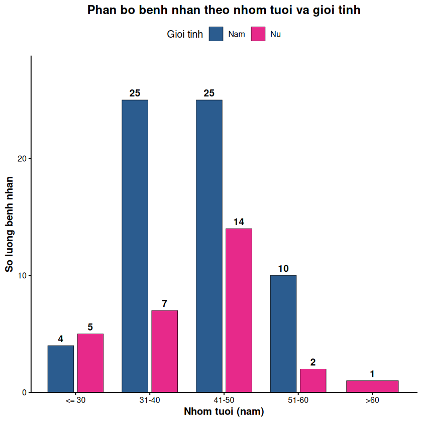
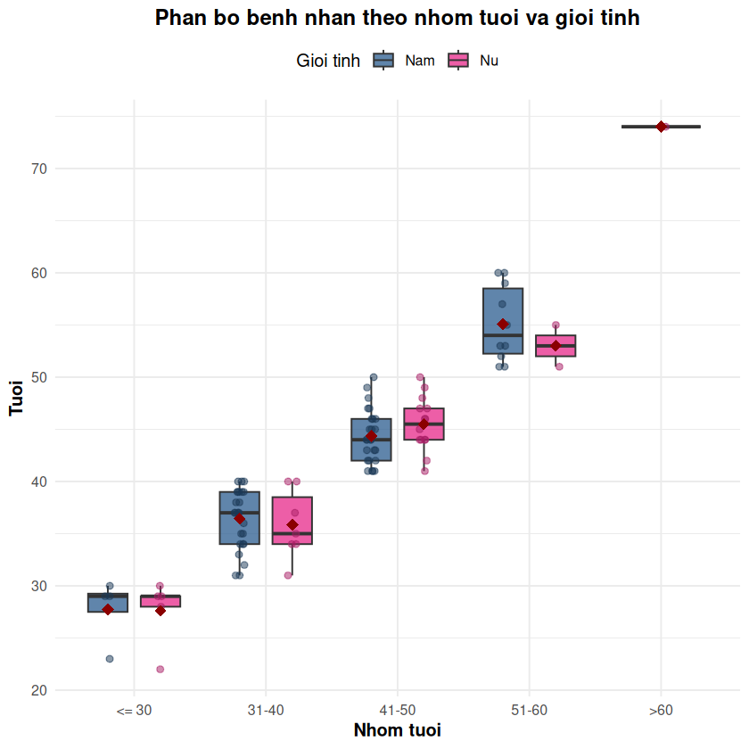
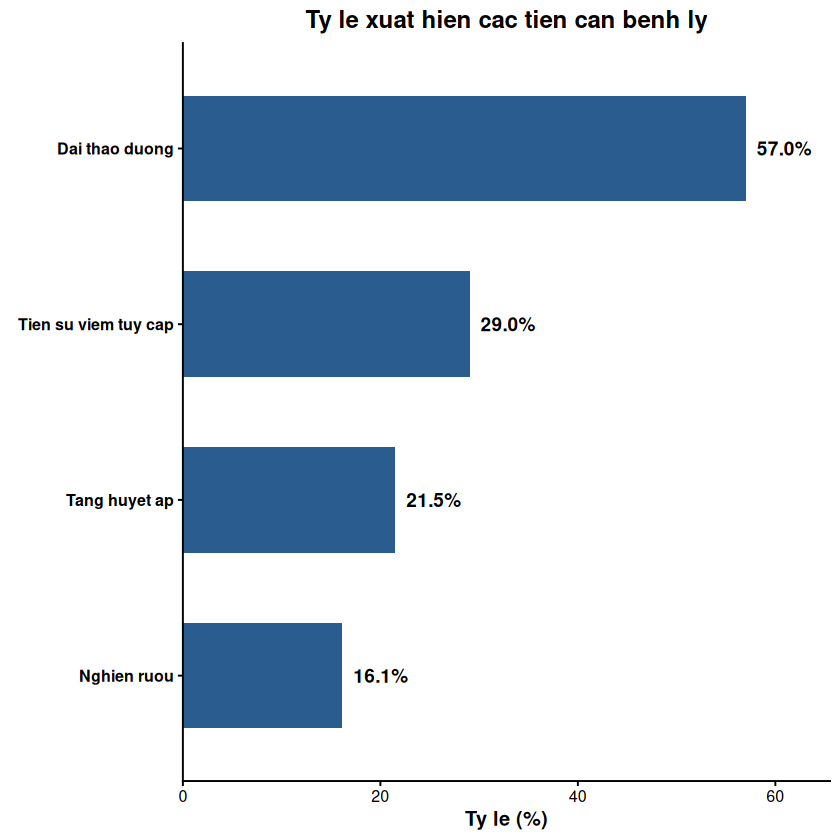
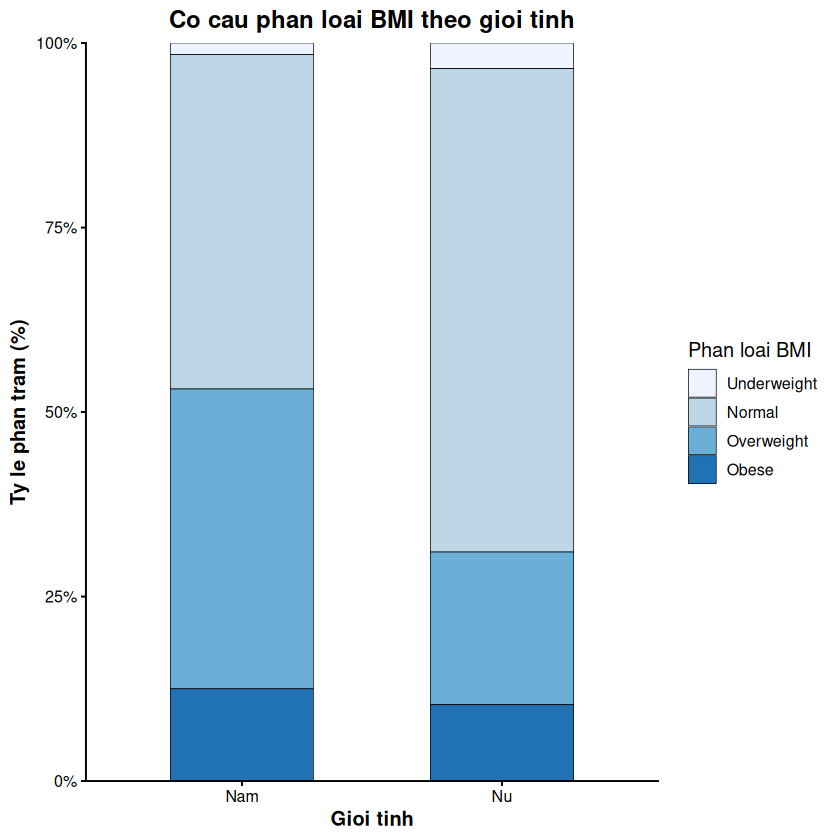
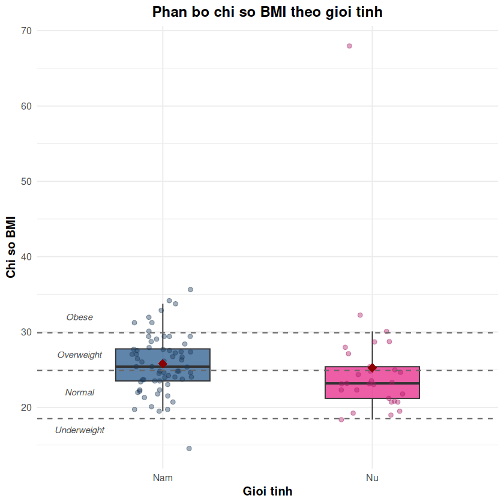
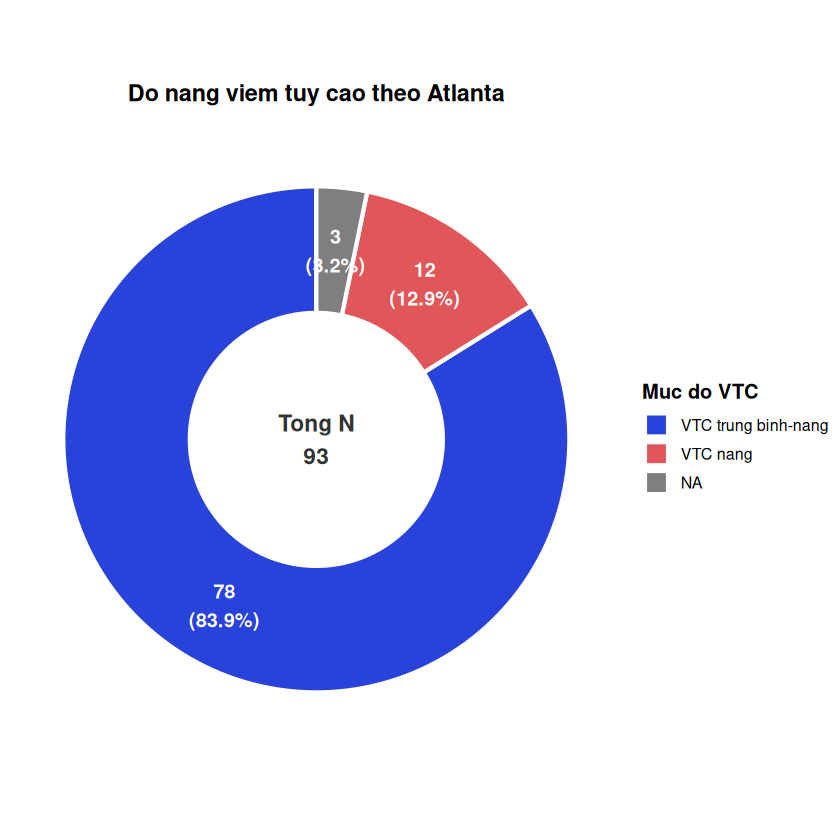
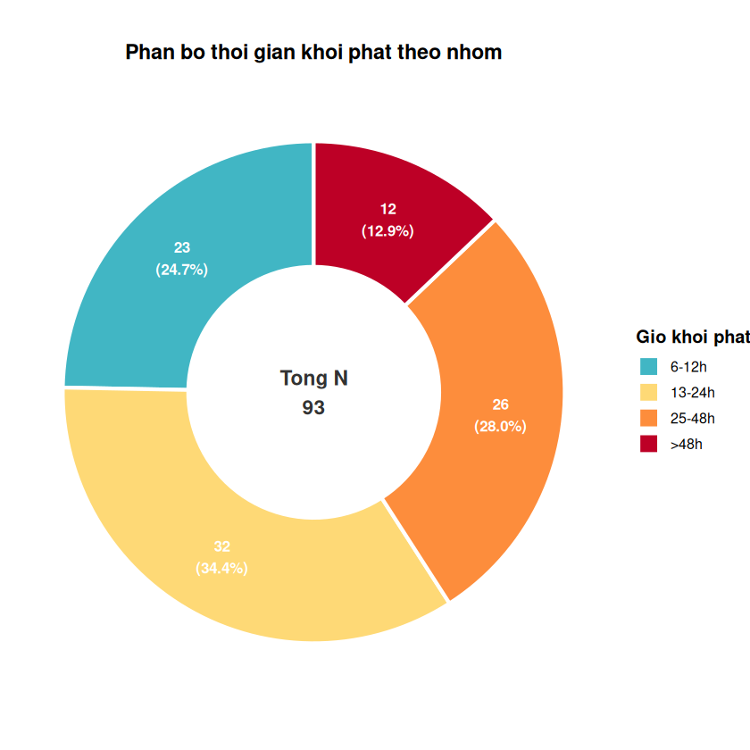

## **Tuoi**
|**Đặc điểm**              | **Chung** (N = 93) | **Nam**  N = 64 | **Nu**  N = 29 |
|:-------------------------|:------------------:|:---------------:|:--------------:|
|__Tuổi trung bình (năm)__ |    41.81 ± 8.64    |   41.91 ± 7.91  |  41.59 ± 10.24 |
|__Phân nhóm tuổi__        |                    |                 |                |
|<= 30                     |      9 (9.7%)      |     4 (6.3%)    |    5 (17.2%)   |
|31-40                     |     32 (34.4%)     |    25 (39.1%)   |    7 (24.1%)   |
|41-50                     |     39 (41.9%)     |    25 (39.1%)   |   14 (48.3%)   |
|51-60                     |     12 (12.9%)     |    10 (15.6%)   |    2 (6.9%)    |
|>60                       |      1 (1.1%)      |     0 (0.0%)    |    1 (3.4%)    |

## **Benh ly kem theo**
|**Đặc điểm**                | **Chung** (N = 93) | **Nam**  N = 64 | **Nu**  N = 29 |
|:---------------------------|:------------------:|:---------------:|:--------------:|
|__Tiền căn đái tháo đường__ |                    |                 |                |
|Không                       |     40 (43.0%)     |   28 (43.8%)    |   12 (41.4%)   |
|Có                          |     53 (57.0%)     |   36 (56.3%)    |   17 (58.6%)   |
|__Tăng huyết áp__           |                    |                 |                |
|Không                       |     73 (78.5%)     |   52 (81.3%)    |   21 (72.4%)   |
|Có                          |     20 (21.5%)     |   12 (18.8%)    |   8 (27.6%)    |
|__Tiền căn nghiện rượu__    |                    |                 |                |
|Không                       |     78 (83.9%)     |   49 (76.6%)    |  29 (100.0%)   |
|Có                          |     15 (16.1%)     |   15 (23.4%)    |    0 (0.0%)    |
|__Tiền căn viêm tụy cấp__   |                    |                 |                |
|Không                       |     66 (71.0%)     |   45 (70.3%)    |   21 (72.4%)   |
|Có                          |     27 (29.0%)     |   19 (29.7%)    |   8 (27.6%)    |

## **BMI**
|**Characteristic** | **Chung** (N = 93) | **Nam**  N = 64 | **Nữ**  N = 29 |
|:------------------|:------------------:|:---------------:|:--------------:|
|__Phân loại BMI__  |                    |                 |                |
|Underweight        |      2 (2.2%)      |    1 (1.6%)     |    1 (3.4%)    |
|Normal             |     48 (51.6%)     |   29 (45.3%)    |   19 (65.5%)   |
|Overweight         |     32 (34.4%)     |   26 (40.6%)    |   6 (20.7%)    |
|Obese              |     11 (11.8%)     |    8 (12.5%)    |   3 (10.3%)    |

**Co 1 mau outlier can nang 174kg, cao 160cm**

## **Do nang viem tuy cao theo Atlanta**
|  **Do nang VTC**    | **Tan suat** (n) | **Ty le** (%) |
|:--------------------|:----------------:|:-------------:|
|VTC trung bình-nặng  |        78        |      83.87    |
|VTC nặng             |        12        |      16.13    |

## **Thoi gian khoi phat den nhap vien**
|  **Dac diem**    | **Tan suat** (n) | **Ty le** (%) |
|:-----------------|:----------------:|:-------------:|
| __Mean ± SD__ | 33.81 ± 20.15 | | |
| __Min - Max__ | 6.0 - 72.0    | | |
|< 6    |        0         |      0         |
|6-12   |        23        |      24.73     |
|13-24  |        32        |      34.41     |
|25-48  |        26        |      27.96     |
|> 48   |        12        |      12.90     |
|Tong   |        93        |      100       |

