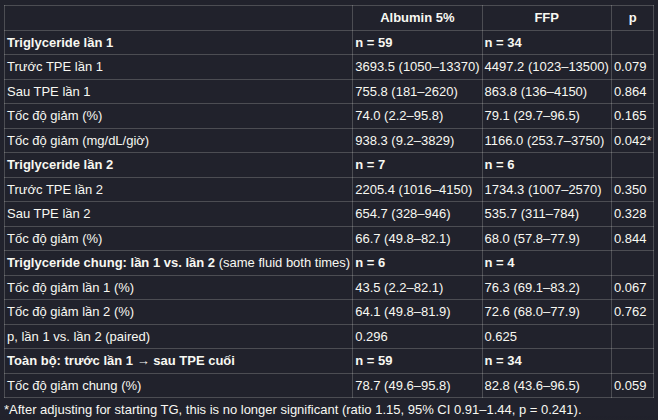
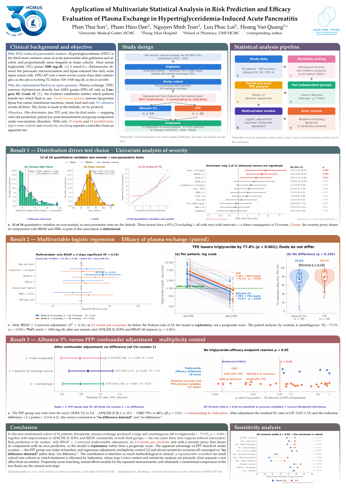

# Application of Multivariate Statistical Analysis in Risk Prediction and Efficacy Evaluation of Plasma Exchange in Hypertriglyceridemia-Induced Acute Pancreatitis.

**Cỡ mẫu:** 93 bệnh nhân, 59 TPE bằng albumin 5% và 34 bằng FFP.

**Thiết kế :** quan sát, tiến cứu, 6/2018 – 6/2023, tại khoa Hồi sức cấp cứu BV Chợ Rẫy và khoa Hồi sức tích cực BV Đại học Y Dược TP.HCM.

**Tiêu chuẩn chọn:** ≥ 18 tuổi, TG nhập viện ≥ 1000 mg/dL, APACHE II ≥ 8, được TPE.

**Tiêu chuẩn loại:** đã TPE ở tuyến trước, hoặc bệnh nhân/gia đình không đồng ý TPE.

**Ket qua chinh**

---

